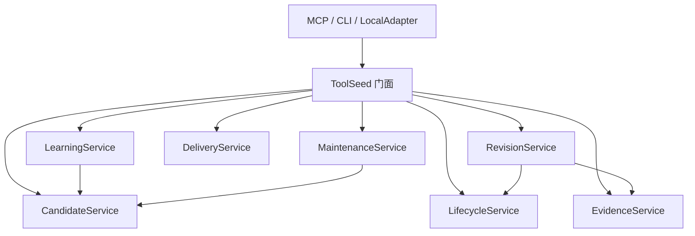

# Core 领域服务与宿主共享学习规则

日期：2026-10-28。实现基于前七项修复后的源码，尚未提交或同步实际宿主。公开五工具、35 个门面方法签名（含构造函数）与 Schema v7 保持一致；本轮没有新增数据库迁移。

## Core 组合关系

`ToolSeed` 统一门面由 2088 行缩为 297 行，保留参数签名、响应语义、公共调用失败审计，以及既有 Store/Registry/Evidence 实例。通过组合构造服务，领域模块不接收或回调整个门面。

| 模块 | 职责与依赖 |
| --- | --- |
| `candidates.py` | 候选写入、身份去重、读取基线检查；提供明确要求外层事务的写入入口 |
| `learning_service.py` | 新经验与复用反馈，调用 CandidateService，观察和候选同事务写入 |
| `lifecycle.py` | 候选提升、版本回退、隔离、释放和归档；统一候选提升门禁 |
| `evidence_service.py` | 验证证据、有效性、观察和任务结果的管理用例 |
| `maintenance_service.py` | 维护决策、失败诊断、修复提案；调用 CandidateService 保存修复版本 |
| `delivery.py` | 搜索、完整方法交付、调用活动审计和统计 |
| `revisions.py` | 宿主验证收据；显式依赖 EvidenceService、LifecycleService 完成验证及提升 |
| `service_support.py` | 少量来源整理、版本沿袭查询、响应构造和错误常量，不依赖上层服务 |

原有 `learning.py`、`reuse.py`、`knowledge.py` 等继续负责输入规范化、经验渲染与结构检查；Registry/Evidence 继续负责存储访问。没有通过继承混入或动态方法转发实现拆分。

所有服务共用同一个 Store。学习用例持有 IMMEDIATE 事务，候选与学习观察一起成功或回滚；修订收据、版本验证、晋升和最终审计在同一个外层事务内完成。内部嵌套继续使用既有 Store 事务实现，不另开连接或提前提交。无外层事务时调用 `save_in_transaction` 会直接拒绝写入。

事务归属使用 `Store.transaction_active`，兼容尚未开始 SQLite 写入的延迟事务；现有嵌套回滚测试也经过真实候选写入，确认候选与活动审计一起回滚。

原有并发、过期基线、证据失效及故障注入回归继续通过统一门面运行。保留 `_ORIGIN_CONTEXT_MAX` 等原有常量引用的兼容性；不把私有业务实现继续挂回门面。

## 一份共享学习规则

权威源码是 `integrations/shared/learning-state.mjs`。输入标准事件与 JSON 状态，返回新状态和可选提示动作；模块不做 IO、调用工具或模型，也不保存任务原文、参数、输出或方法正文。

共同管理工具活动与去重、交付引用、已接受反馈、用户补充、跨回合关联、中断和两类提示预算。普通提炼默认要求六次正常返回且涉及三种工具；失败后出现返回、用户补充等线索单独判断。观察顺序使用事件序号，先返回再失败不会被描述为“失败之后有进展”。

相较之前的 Codex 行为，六次总活动/两种工具和八次单工具活动不再单独触发提炼；两宿主采用同一份较保守规则。接受直接 save/learn 后抑制冗余普通提示，匹配的复用反馈只关闭对应交付；同一 invocation 的重复交付不会重开已完成反馈。交付和后续活动均不证明实际采用或任务成功。

提示状态区分 proposed、returned、committed；只有显式拒绝才能释放尚未提交的提议，未知回执不写成确认，也不反复追问模型。

- DSH 保留 agent/pre-step 准入、工具可见性、取消信号和 session/event 提交确认。未获准或工具不可见时不消耗提示机会。
- Codex 保留 Hook 事件、文件锁、原子写入与取消标记；返回 additionalContext 只记录 returned，宿主是否写入上下文保持 unknown。
- Codex 工作流状态升级为 v2；旧状态仅迁移通过格式检查的待反馈引用，重新建立学习计数，丢弃旧行为标记和未知字段。数据不进入能力库。

共享范围为经验提炼及复用反馈规则。召回 IO、工具权限、修订执行与原生事件适配保留各宿主实现。

## 构建与安装

Codex 安装快照包含 `integrations/shared/learning-state.mjs`，源码指纹覆盖它。DSH 构建将同一文件按字节复制为 `lib/learning-state.mjs` 并纳入插件包；官方 Python 打包入口也从权威源码同步，避免本地改了规则却打出旧副本。生成文件由构建维护，测试校验其与权威源码一致。

共享测试已加入 Linux/Windows/macOS × Node 22/24 CI。相同事件序列分别进入真实 DSH 学习适配和 Codex 工作流，断言共同业务决策一致，同时保留各自的权限、取消与回执测试。

## 验证材料

公开签名通过重构前后 AST 对比，35 项一致。隔离 wheel 在不引用源码的环境中完成学习、修订、验证提升与交付，并检查事务入口约束和五工具注册。

隔离原生 Codex 安装与修复检查通过，安装快照中的真实 Hook 子进程能够加载共享模块，发出学习提示并关联用户纠正。没有模型调用，没有修改实际宿主配置或实际能力库。

私人验证材料位于 `.test-data/architecture-refactor-20261028/`。这些检查证明代码契约和安装链路，未重新进行真实模型的端到端学习试验。

最终本地结果：Python 417 项（416 通过、1 项条件跳过）；Node 157 项全部通过；编译、Ruff 和 mypy（35 个源文件）通过；离线 wheel 独立安装与原生 Codex 快照/Hook 检查通过。CI 已配置共享测试，本轮未在远程触发。
