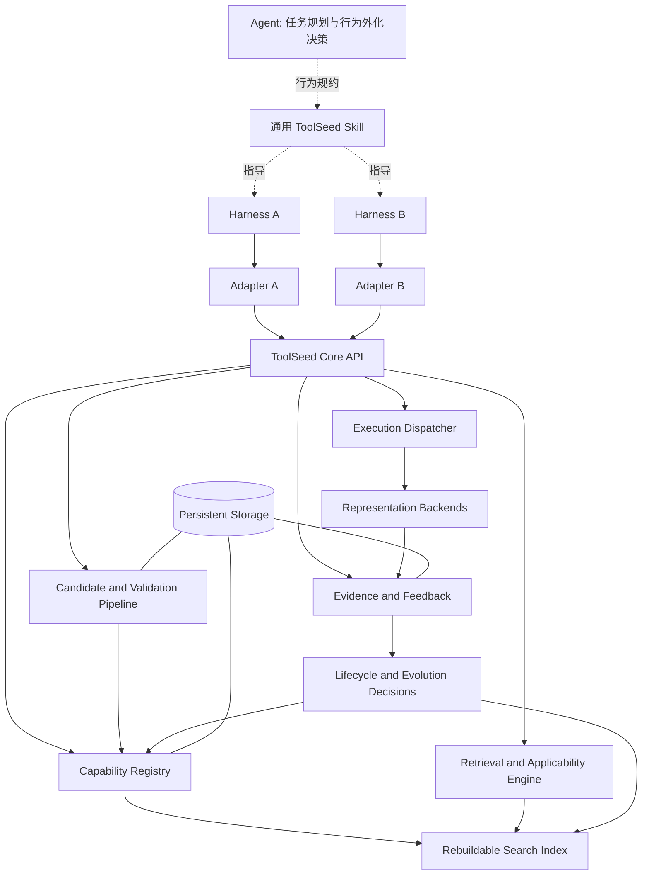

# ToolSeed：面向 Agent 的可验证能力积累系统

> **文档类型：** 规范性设计文档（Normative Design Specification）  
> **读者：** 代码生成型 AI、ToolSeed Core 实现者、Harness Adapter 实现者、测试与安全审查者。  
> **目标：** 直接指导实现、测试和验收。  
> **状态：** 新版整体设计；取代旧版以“保存和调用脚本”为中心的产品定义。  
> **规范词：** “必须 / MUST”表示强制要求；“不得 / MUST NOT”表示禁止；“应该 / SHOULD”表示默认要求，除非有明确理由；“可以 / MAY”表示可选能力。

---

## 0. 给实现 AI 的最高优先级指令

实现时必须遵守本节。遇到与后文局部描述冲突时，按本节及相关安全约束优先处理。

1. **ToolSeed 的中心对象是 Capability（能力），不是脚本。** 脚本只是可执行能力的一种实现形式。
2. ToolSeed 的目标是让 Agent 能够识别值得复用的行为，选择合适的执行形式，把行为提炼为候选能力，在满足验证与安全门槛后投入复用，并根据后续证据维护它们。
3. Agent 可以选择直接推理、临时程序化执行、复用已有能力或创建候选能力。**不得强迫每个任务创建能力，也不得强迫 Agent 复用不适用的能力。**
4. **候选生成、验证、激活和演进是不同阶段。** AI 提议、元数据自述、Lint 通过或单次成功，都不能单独授予正式执行权限。
5. ToolSeed 是以 Harness 插件/扩展形式交付的产品，但 Core 必须与任一具体 Harness 解耦。宿主差异只能通过 Adapter Interface 进入 Core。
6. 面向 Agent 保持四个主要公共 API：`toolbox_search`、`toolbox_save`、`toolbox_run`、`toolbox_stats`。Harness Adapter 只注册这四个 ToolSeed 公共工具；Capability 通过目录、`capability_id` 和 `toolbox_run` 动态发现与调用，不得为每个能力或 SDK 辅助函数动态注册原生工具。内部可以有不暴露给 Agent 的管理接口和 Adapter 事件接口，但不得为了状态查询随意添加第五个 Agent 公共工具。
7. **事实、推断和未知必须分开。** 不知道任务是否成功时记录 `unknown`；不得用退出码、调用次数或 Agent 的自我评价伪造任务成功证据。
8. 源实现版本不可变。任何实现、契约、依赖、权限或执行配置的实质性变更，都必须产生新的版本或新的验证上下文。
9. 执行安全由运行时与策略引擎强制实施；描述、元数据、Skill、代码注释、模型承诺和静态检查都不能代替实际授权与隔离。
10. 先完成端到端最小闭环，再按可观测问题扩展。不得预先引入不必要的分布式架构、向量数据库、知识图谱、自治多代理或任意工作流引擎。
11. 不得将原始思维链作为能力积累的必要输入或默认持久化内容。采集结构化行为事件、外部动作、输入输出摘要、错误与可信结果信号即可。
12. 最终成败以未来任务上的净收益、可靠性和可泛化性衡量，而不是能力条目数量、保存数量或调用次数。
13. **Token 与模型调用开销是硬性设计约束。** 不得要求每个任务都额外进行能力反思、价值评估或模型裁判；应把评估尽量融入现有规划，按触发条件开展，并优先使用确定性验证。
14. **能力积累必须考虑摊销成本。** 统计创建、验证、检索上下文、复用适配与维护的额外开销，并与后续任务节省的 Token、模型调用、时间和人工成本比较。无法取得精确 Token 数据时标记为未知或估算，不得伪造精确值。
15. **事实来源与派生视图必须分离。** 不可变能力版本和带来源的原始证据是事实来源；观察、摘要、排序特征和能力关系图是可更新、可重建的派生信息，不得覆盖原始证据或单独授权执行。
16. **检索必须渐进加载。** 先应用硬约束，再执行低成本召回和排序，最后只加载少量候选的必要详情；不得默认将整个能力库、全部源码或完整历史记录注入上下文。
17. **经验综合必须按需触发。** 运行记录可以低成本、结构化地采集；跨运行的归纳、能力地图更新或候选修复仅在证据量、风险、明确请求或可观测异常足以支持其成本时触发。
18. **作用域与执行权限必须分别判断。** 能力可见、可读、可修改、可发布和可执行是不同权限；共享能力定义不意味着共享凭据、工作区或运行权限。
19. **固定工具面，动态能力目录。** 能力数量增加不得改变 ToolSeed 对 Agent 暴露的四个公共工具定义。不得为单个 Capability 注册独立原生工具；所有能力通过目录检索和稳定 ID 路由。
20. **检索成本必须逐级升级。** 默认从当前任务内可复用结果、直接 ID 查找和确定性元数据/关键词检索开始；只有低成本检索不足或任务确实复杂时，才升级到语义召回、查询分解或模型重排。`toolbox_search` 不得暗中为普通搜索触发额外 LLM 调用。
21. **能力编写必须遵循统一契约与 SDK。** 统一 Manifest Schema、入口约定、运行结果协议与错误语义。能力作者必须优先使用受支持的 ToolSeed SDK，不得为每个脚本重复实现公共协议或复制粘贴另一份运行时。
22. **能力库必须可治理、可收敛。** 保存前应执行低成本精确去重并可提示疑似重复项；允许隔离、合并评估、替代和退役。不得因数量增长自动删除历史证据，也不得把调用频率当作保留或删除能力的唯一依据。

---

# 第一部分：产品与核心模型

## 1. 产品定义

ToolSeed 是一个**跨 Harness 的外部化能力积累层**。它使 Agent 在解决真实任务时能够：

1. 检索已有能力，并判断是否适用于当前任务；
2. 选择最合适的执行方式，而不默认把所有行为转成脚本；
3. 从有效解决过程提炼可复用候选能力；
4. 验证候选能力的接口、适用边界、权限和执行行为；
5. 在满足对应能力类型的最低门槛后，将其放入可复用能力库；
6. 记录未来调用、失败、真实任务结果与适用上下文；
7. 根据证据修订契约、检索排序、实现版本、状态或治理建议；
8. 在价值不足、过期或存在风险时降低优先级、隔离、回滚或退役能力。

ToolSeed 的积累是外部化、可检索、可调用、可版本化、可验证的能力积累。它**不等同于底层模型参数训练**，不保证每次任务都会产生能力，也不承诺只要安装插件就会自动提升 Agent 的通用智能。

### 1.1 产品边界

ToolSeed 负责：

- 能力身份、元数据、版本、契约和生命周期；
- 候选能力接收、持久化、验证和晋升流程；
- 能力检索、兼容性筛选和结果排序；
- 固定的 Agent 工具入口与动态能力目录，避免每个 Capability 扩张 Harness 工具清单；
- 统一的能力编写契约、最小 SDK、Manifest Schema、错误与结果协议；
- 受控的能力调用及统一执行结果；
- 执行证据、任务结果证据、版本关联与失败归因；
- 基于证据提出改进、隔离、回滚和退役决策；
- 通过 Adapter 将相同核心语义接入不同 Harness。

ToolSeed 不负责：

- 取代 Agent 的通用任务规划与推理；
- 要求每个任务执行一遍完整的能力积累流程，或为每个普通任务强制增加一次模型调用；
- 为了统计成本而假装拥有 Harness 或模型提供方未暴露的精确 Token 计量；
- 保证 Agent 一定识别所有沉淀机会；
- 自动将每条执行轨迹完整复制成能力；
- 自动把任何候选代码视为可信程序；
- 自动扩大权限以使能力能够运行；
- 在没有可信证据时宣称任务成功或成本下降；
- 让一个能力在所有 Harness、操作系统、权限域与运行时中无条件可移植。

## 2. 核心概念与术语

实现必须严格区分以下对象。

### 2.1 Task（任务）

具有目标、输入、约束和可能的验收条件的一次工作。任务可能由 Harness 提供显式 ID，也可能只能提供会话级或未知关联信息。

### 2.2 Behavior Observation（行为观测）

任务执行期间可观测到的外部行为记录，例如工具调用、命令执行、输入输出摘要、文件变更摘要、错误、重试、测试结果和状态转换。它不是完整思维链，也不应默认包含模型内部推理文本。

### 2.3 Solution（解决方案）

Agent 为完成一个任务采用的整体或局部方法。可能混合了自然语言推理、现有工具、临时代码、人工确认和外部服务。

### 2.4 Candidate Capability（候选能力）

从一个或多个解决过程提炼出来、准备接受验证的可复用单元。候选能力尚不自动获得正式调用资格。

### 2.5 Capability（能力）

具有稳定身份、明确用途、适用条件、执行形式、契约、权限要求、依赖、验证证据和版本历史的可复用任务解决单元。

概念上：

`Capability = Identity + Purpose + Applicability + Representation + Contract + Policy + Evidence + Version History`

此表达为领域模型，不要求每个字段对应单独数据库表。

### 2.6 Capability Representation（能力表示形式）

描述能力内容如何表达、如何被执行。第一版定义三类：

- `procedure`：程序性技能或操作规约，由 Agent 根据指引执行；本身不等于一个独立运行的程序。
- `executable`：具备明确输入输出契约、由受控运行时执行的程序，例如单文件脚本。
- `workflow`：由有限、明确的步骤与条件组成的流程，可调用其他已注册能力。MVP 可以暂不开放创建与执行，但数据模型不得把未来支持工作流的可能性写死。

不将“组合能力”定义为另一套完全独立的核心类型；组合可由受约束的 Workflow 引用其他 Capability 实现。

### 2.7 Invocation（调用记录）

一次能力被选择或调用的记录。对 `executable` 来说包含真实程序运行；对 `procedure` 来说可以表示 Agent 已获取并开始采用该程序性指引。必须区分“指引已交付”“程序已执行”和“任务结果已确认”。

### 2.8 Execution Evidence（执行证据）

能够说明一次运行发生了什么的事实，例如退出码、异常、超时、协议校验结果、测试输出摘要、资源消耗、执行时长和安全拒绝原因。

### 2.9 Task Outcome Evidence（任务结果证据）

能够支持“能力是否帮助任务达成目标”的结果信号。证据源必须被标识，例如独立测试、Harness 可靠任务结束事件、外部系统确认或人工评审。Agent 的自我报告可以作为低可信度声明保存，但不得伪装成独立验证。

### 2.10 Evidence Maturity（证据成熟度）

描述某能力或版本已经得到哪些类型、哪些强度的验证。它与生命周期状态分开存储。一个 `ready` 版本可以尚未获得广泛任务成功证据。

### 2.11 Save Job（保存任务）

处理一次能力保存请求的工作单元。它的状态不等于版本的生命周期状态（见 §11.1）。`save_job=completed` 不代表其产物一定 `ready`。

## 3. 核心设计判断

### 3.1 能力优先于代码形式

上层逻辑以 Capability 为统一对象，底层可使用不同 Representation。检索、版本追踪、证据关联和权限校验不能只针对脚本编写。

### 3.2 执行方式选择是显式决策

Agent 在规划子任务时，可以选择：

1. `reason_inline`：直接推理或手动操作；
2. `temporary_program`：临时生成程序，只用于当前任务，不默认入库；
3. `reuse_capability`：复用已有能力；
4. `propose_capability`：提出新的候选能力。

这些是 Agent 的决策模式，不是必须依次执行的流水线阶段。Agent 可以跳过某些选项。

### 3.3 行为外化不是默认动作

能力创建具有代码生成、测试、维护、检索噪声和安全成本。只有预期复用价值或可靠性收益足以覆盖这些成本时，才值得候选化。不得以“本次成功”作为唯一入库条件。

### 3.4 原始轨迹不是能力本身

轨迹可能含任务特有参数、偶然成功、冗余步骤、敏感数据或不可靠假设。提炼过程必须抽取必要结构，声明可变参数和适用边界，去除不必要的偶然细节。

### 3.5 证据决定能做出的声明

结构检查证明结构满足规则；测试证明指定测试条件下的行为；任务证据支持对任务结果的判断；跨实例的复用实验支持更广泛的收益判断。这些证据不能互相替代。

### 3.6 不要为了“自动学习”而静默自我修改

反馈可以影响排序、生成候选版本、建议隔离或触发验证任务。但任何代码更新必须产生新版本并重新评估；任何权限变化必须经过策略检查；任何激活变化必须可追踪和可回退。

### 3.7 额外开销必须有边界

- 不得在每个任务结束后强制触发独立的模型反思调用。
- 不得为一次简单、明显一次性的操作加载完整能力目录、完整 DESIGN、全部源码或全部历史证据。
- 能通过 Schema、Lint、哈希、确定性测试或运行时检查验证的问题，不得默认再调用模型重复裁判。
- 应优先把轻量的外化判断合并进 Agent 原有任务规划或结束总结；只有出现明确触发信号时才展开更深评估。
- 任何优化均应同时报告其产生的额外成本与后续收益，不得只报告复用带来的节省。

## 4. Agent 的外化决策机制

本节定义 ToolSeed 如何促使 Agent 有意识地将合适的行为程序化，但不把智能决策完全硬编码在 Core 中。

### 4.1 触发场景

Agent 应在以下情况评估外化是否值得：

- 相似子任务在当前任务或历史任务中反复出现；
- 子任务包含大量确定性处理或机械重复步骤；
- 输入、处理过程和输出已经较稳定；
- 为同类问题反复执行相同排错或验证流程；
- 搜索发现已有能力的边界清晰，但仍需要重复编排多个操作；
- 当前任务产生了可复现的解决方法，并且未来存在合理的重复使用场景。

一次性、极简单、强烈依赖当前状态、无法界定接口、涉及敏感临时数据或验证成本明显超过收益的行为，通常不值得沉淀。外化评估应当采用廉价的触发式判断；不得仅为确认“没有沉淀机会”而专门增加一次模型调用。

### 4.2 建议决策模型

Agent 应对外化价值做定性或近似量化判断。可采用以下概念模型：

`V_externalize = B_future_reuse + B_reliability + B_latency - C_creation - C_validation - C_model_calls_and_tokens - C_context_loading - C_maintenance - C_security - C_retrieval_noise`

其中，`C_model_calls_and_tokens` 包含生成、分类、反思、裁判和修复期间的额外模型调用及输入/输出 Token；`C_context_loading` 包括额外注入的 Skill、描述、契约、源码与历史记录。避免把同一成本在多个项中重复计算。若未来任务收益未知，必须把它当作不确定性，而不是默认收益为正。

这不是要求 Agent 计算精确货币价值，而是要求其考虑成本收益。MVP 只使用短规则和现有任务上下文作近似判断，不实现复杂的在线价值模型，也不得为了作出这个判断再强制触发独立模型调用。只有实际观测证明简单规则不足时，才增加统计或学习型决策机制。

### 4.3 搜索优先原则

对于可能形成可复用程序化行为的子任务，Agent 在重新实现前应优先调用 `toolbox_search`。若无合理匹配，或现有候选不满足契约、环境、权限或适用条件，可以新建临时实现。

该原则不意味着每一个简单动作都必须搜索；对于明显一次性、极短且不存在合理复用价值的操作，Agent 可以直接执行。相似子任务在同一任务内已检索且上下文未变化时，应复用本次结果，不要重复发送语义相同的搜索。Skill 应明确这些例外，以减少不必要的检索、工具调用和返回内容。

### 4.4 临时程序与正式能力的区分

临时程序解决的是本次任务；正式能力服务于可预期的后续任务。

- 临时程序默认不进入正式索引。
- Agent 可以在任务完成后决定不保存。
- 保存时应尽可能提取通用输入而非固化任务特定值。
- 临时程序涉及敏感参数、凭据或用户数据时，不得将这些数据随源码一起沉淀。
- 如果实现尚未达到对应表示形式的验证门槛，应保留为 `candidate`，而非为了让 Agent 方便调用直接晋升。

### 4.5 任务结束后的沉淀评估

当 Harness 提供可靠任务结束事件时，Adapter 可以提示 Agent 或触发可选沉淀评估；不提供可靠事件时，由 Skill 指导 Agent 自行评估。系统不得伪造任务结束事件。

沉淀评估至少回答：

1. 这次任务中的哪些子步骤可能在未来重复出现？
2. 已有能力是否能够覆盖？
3. 哪些步骤是稳定规则，哪些需要模型判断？
4. 适合 `procedure`、`executable` 还是将来的 `workflow`？
5. 输入输出、适用条件、负面适用条件和副作用能否说清楚？
6. 是否存在敏感数据或不适合持久化的信息？
7. 能否设计独立验证案例？
8. 预期收益是否足以覆盖创建与维护成本？

如果上述问题没有合理答案，允许不保存，或只保存为低成熟度候选。该评估应尽量复用已有规划、测试及结果摘要；不得为了填写完整评估清单而自动增加独立的模型调用。对于无明显触发信号的普通任务，采用轻量判断或直接跳过。

### 4.6 外化成本等级

Agent 应采用成本分级，而不是每次都执行同样深度的积累流程：

| 等级 | 适用情形 | 默认动作 | 额外模型开销规则 |
|---|---|---|---|
| `L0: ordinary` | 一次性、简单、复用价值不明显的任务 | 正常解决任务；不提炼能力 | 不触发专门反思/裁判调用；仅按规则决定是否检索 |
| `L1: lightweight` | 有一定复用可能，或可直接复用已有能力 | 简短搜索、复用已有任务摘要，必要时提出候选 | 优先复用当前模型回合中的判断；不要为填充元数据单独调用模型 |
| `L2: deliberate` | 高重复成本、可预期多次复用、潜在可靠性收益明显，或失败代价较高 | 进行明确的候选抽象、测试设计与必要修复 | 可以增加模型调用，但必须说明触发依据，并把实际开销记录进净收益评估 |

这不是公共 API，也不是必须由 Core 执行的固定状态机，而是 Skill 与 Agent 使用的决策纪律。具体 Token 数上限不应在通用设计中写死，因为模型、Harness 和计量方式不同；实现可以提供可配置预算，但默认应优先采用低开销策略。达到预算限制时，应安全降级为保留候选、跳过非必要优化或报告未知，不得绕过必要安全门禁。

## 5. 总体架构



核心模块：

- **Harness Adapter：** 宿主工具注册、参数映射、上下文和可信事件适配。
- **Core API：** 四个稳定公共 API，负责参数校验、错误语义与领域服务调用。
- **Capability Registry：** 能力身份、版本、生命周期、激活指针、契约、权限和来源。
- **Candidate and Validation Pipeline：** 保存接收、元数据规范化、结构验证、类型相关验证与晋升判定。
- **Retrieval and Applicability Engine：** 硬约束筛选、相关性排序、能力适用性判断。
- **Execution Dispatcher：** 根据 Representation 选择受控后端；所有执行通过统一授权与结果标准化。
- **Evidence and Feedback：** 保存执行事实和任务结果信号，按版本关联并分类失败。
- **Lifecycle and Evolution Decisions：** 提出状态、检索、修复或退役动作。不得在缺少策略授权时修改代码或提升权限。
- **Cost Observation（逻辑职责，不要求独立服务）：** 在可获得时记录模型调用数、输入/输出 Token 或合理估算、能力创建与验证开销、搜索返回规模及后续复用收益。该职责可由 Evidence and Feedback 与 Adapter 共同承担。
- **Persistent Storage：** 事实数据与能力内容的持久化。搜索索引必须可重建。

MVP 中这些模块可以都在同一进程或本地服务中实现，不要求分别部署。

## 6. 跨 Harness 的架构边界

### 6.1 基本要求

- Core 的数据模型、API 语义、状态协议、搜索逻辑、保存处理、版本和证据规则必须与具体 Harness 解耦。
- 每种 Harness 用一个薄 Adapter 处理工具注册格式、参数 Schema、事件、工作区、权限上下文和结果映射。
- 不得将 Harness 私有 SDK 对象或私有生命周期状态泄漏到 Core 域模型。
- 同一个能力库可以服务多个 Harness，但每次执行仍必须检查运行时、权限、依赖、工作区与宿主能力兼容性。
- 不承诺一个二进制插件无需适配就能在所有 Harness 中运行。只要求核心语义和数据协议可移植。
- 第一版可以只交付一个 Adapter，但必须通过独立的 Adapter Interface 与 Core 契约测试，且明确这是发布范围限制。

### 6.2 Adapter 最小能力声明

Adapter 应实现或声明以下能力（语言接口、协议 Schema 或等价形式均可）：

- `register_tools()`：以宿主要求的方式注册四个公共工具。
- `invoke_tool(name, args)`：调用 Core 并保持错误语义。
- `get_context()`：提供可获得的 task/session ID、workspace、runtime、permission context；未知值必须显式为 `unknown`。
- `capabilities()`：声明是否支持 Hook、任务结束事件、工作区事件、权限确认、取消执行、可靠任务结果信号等。
- `emit_event(event)`：仅在宿主真实支持对应事件时调用。
- `health_check()`：检查 Core 连接、协议版本及宿主兼容性。
- `translate_error(error)`：仅做协议映射，不得把未知或失败伪装成成功。

### 6.3 任务结果信号

Adapter 必须将宿主信号映射到规范化的 `TaskOutcomeSignal`，不得自行创造含义相近但不可比较的成功类型。每条信号至少包含 `signal_type`、`source_type`、`outcome`、`observed_at`、`task_id/session_id`（若可得）、关联 `invocation_id`/`capability_id`/`version_id`（若相关）以及原始来源引用或脱敏摘要。

`signal_type` 枚举至少包括：`task_completed_reported`、`tests_passed`、`tests_failed`、`external_confirmation`、`human_review_passed`、`human_review_failed`、`agent_self_reported_success`、`agent_self_reported_failure`。`source_type` 至少包括 `harness`、`test_runner`、`external_system`、`human`、`agent`。`outcome` 统一为 `success`、`failure`、`partial` 或 `unknown`。枚举表示信号语义，不代表各信号拥有相同可信度；可信等级由 `source_type`、验证方式和关联证据表达。

Harness 若提供可靠的任务完成或外部验证信号，Adapter 应将其作为带来源、时间和关联 ID 的证据传递给 Core。不能把单纯的 `task_completed_reported` 解释成任务成功，也不得把 Agent 自我报告提升为独立验证。如果未来收到未知 `signal_type`，应保留原始类型并标记为未识别/不参与成功判定，不得静默映射为成功。

如果宿主没有任务结果能力，ToolSeed 仍然可以记录能力调用与执行结果，但 `task_outcome` 必须保持 `unknown`。缺失信号不是失败，也不是成功。

### 6.4 Skill 的职责

Skill 用于指导 Agent 如何使用 ToolSeed，不是安全边界，也不是唯一的状态机实现。

Skill 应表达通用行为策略，并使用 Core 公共 API。Harness 所需的 Skill 文件格式可以在打包层生成，但核心规则不应因适配不同 Harness 而分叉。

## 7. 能力表示形式

### 7.1 `procedure`

适用于可复用的操作策略、排查顺序、判断规则和需要 Agent 在上下文中完成的步骤。

要求：

- 使用明确的目的、适用条件、不适用条件和步骤。
- 明确哪些步骤需要外部工具或用户授权。
- 不得含有要求绕过权限、泄露秘密或隐藏副作用的内容。
- 有条件时提供最小输入示例、成功信号和停止条件。
- 不能把自然语言指导表述成“已由 ToolSeed 自动执行”。

执行语义：`toolbox_run` 取得已启用 Procedure 时，返回 `mode=agent_guided` 与经过策略处理的指引内容，表示指引已交付给 Agent，而不是指引中的每个步骤均已运行。实际步骤的执行结果只有在外部动作可观测或 Harness 提供证据时才能记录。

### 7.2 `executable`

适用于确定性计算、数据处理、格式转换、稳定操作、结构化检查或可由程序实现的子任务。

要求：

- 有结构化输入和输出契约。
- 声明语言/运行时版本、依赖、外部命令和权限。
- 以统一协议传入输入、输出结果和错误。
- 通过受控运行时执行，不在 Core 进程中任意执行不受信任代码。
- 所有实际副作用必须在声明的权限范围内。

MVP 至少支持一种实际运行时；运行时必须以可替换接口封装。

### 7.3 `workflow`

适用于可复用的多步骤过程，包括调用现有能力、条件分支、有限重试和结果校验。

要求：

- 步骤与转移规则是显式、可校验的数据，而不是未经约束的隐式任意代码。
- 子能力引用必须包含稳定的 `capability_id` 和明确的版本策略；生产默认应锁定经过验证的版本。
- 明确失败传播、超时、取消、部分完成和补偿/清理语义。
- 不允许无限循环、无限重试或递归无限调用。
- 每个子调用仍走统一授权、状态检查和证据记录。

Workflow 在扩展阶段实现。第一版若未实现，保存请求必须返回明确的 `UNSUPPORTED_CAPABILITY_KIND` 或将内容保留为不可执行候选，不得静默把 Workflow 当成 Script 执行。

### 7.4 新增表示形式的扩展规则

将来新增 Representation 必须提供：

1. 元数据 Schema；
2. 兼容性判断规则；
3. 执行或交付语义；
4. 安全策略映射；
5. 验证门槛；
6. 统一结果协议映射；
7. 契约测试；
8. 未支持宿主的明确降级行为。

不得仅新增一个 `kind` 字符串就宣称该形式已经被支持。

### 7.5 统一能力编写契约与最小 SDK

目标是让模型把生成成本集中在业务逻辑，而不是每次重新实现输入解析、协议封装、错误格式和运行约定。所有 Representation 共享 Manifest、版本兼容与外层错误语义；不同 Representation 可以有不同内容字段和入口。

#### 可执行能力传输契约与规范化能力包

**可执行能力的保存传输格式是一个 JSON `candidate` 对象，不传目录、不传 zip，也不允许实现者自行发明 `source` 编码。** `manifest` 是对象字段，不是嵌在源码里的常量。对 Python `executable`，最小形状如下：

```json
{
  "manifest": {
    "manifest_schema_version": "1.0.0",
    "name": "parse_json_from_log",
    "kind": "executable",
    "description": "从日志文本中提取 JSON 对象",
    "when_to_use": "日志中包含符合约定的 JSON 对象",
    "not_for": ["二进制日志"],
    "contract": {
      "input_schema": {"type": "object", "properties": {"text": {"type": "string"}}, "required": ["text"]},
      "output_schema": {"type": "object"}
    },
    "runtime": {"language": "python", "runtime_constraint": "受支持的 Python 运行时版本"},
    "dependencies": [],
    "permissions": {"filesystem": [], "network": "deny"},
    "applicability": {"when": [], "not_when": []}
  },
  "implementation": {"source": "def run(input_data, context):\n    ..."},
  "verification": {
    "cases": [
      {"case_id": "basic", "input": {"text": "..."}, "expect": {"status": "success", "output": {}}}
    ]
  }
}
```

上述对象是该传输契约的示例。真实 `manifest.schema.json` 必须定义所有字段的类型、必填性、默认值、未知字段策略和兼容性；示例中的 `...` 不是可通过验证的实现。`manifest` 内只保存一次权威声明，不允许再从顶层复制出一套可产生冲突的同名契约字段。`verification.cases` 只支持受限、结构化、可重复执行的测试用例；任意测试脚本/多文件包不属于该传输契约。

Core 接收该对象后，先验证请求 Schema，再规范化为受控存储中的能力包布局：

```text
<capability-version>/
├── manifest.json       # 从 manifest 对象规范化序列化生成
├── main.py             # 从 implementation.source 生成
└── tests/
    └── contract_cases.json
```

磁盘布局是 Core 管理的内部表示，不是公共 API 的传输格式。Core 必须以确定性方式规范化序列化并计算哈希。只有在 P2 明确定义 `candidate.files[]` 的路径、编码、文件类型、最大尺寸、路径规范化、重复路径拒绝、哈希及解包安全规则后，才允许多文件/zip 形式；不得通过私有字段或把 `source` 偷换为 zip 来提前实现。

对于 `procedure`，使用同样的 `manifest` 对象，并在规范化对象中提供 `content` 文本；它不需要 `implementation.source`。不支持的 `kind` 必须明确拒绝或保留为不可执行候选。

#### 最小 SDK 模块

- `toolseed_sdk/errors.py`：公开稳定错误代码常量、受支持的异常类型与安全消息约定，来源必须与 Core 的权威错误协议一致。
- `toolseed_sdk/protocol.py`：结果序列化、异常归一化和协议校验辅助函数。它是便利库，不是安全或授权边界。
- `manifest.schema.json`：能力元数据的权威 Schema，并使用明确的语义化版本。
- `templates/python-executable/`：只用于生成规范示例；模板直接对应上面的单文件传输协议和入口。
- `AUTHORING.md`：面向生成模型的一页式最小编写规范，只写入口、Manifest、依赖、错误和结果约定；详细说明按需读取，不在普通任务中默认注入完整设计文档。
- `toolseed_sdk/context.py` 只有在存在真实通用需求时才加入；不得为追求结构完整而增加无用接口，也不得借 Context 绕过运行时权限。

#### SDK 的可信供给与执行边界

SDK 由 ToolSeed Runtime 管理的、版本化且对能力代码只读的 Python 运行环境提供；能力包不得携带、vendoring 或复制第二份公共 SDK。启动能力前，可信 Launcher 必须验证目标 Runtime/SDK 的受支持版本、实际加载位置与发行物完整性，并确认其符合 Core 声明的兼容矩阵。任何阶段都不允许运行时自由联网安装或静默下载替代版本。

在支持的实现中，可以使用隔离配置（例如 `python -I`）与 Runtime 自有虚拟环境，避免通过启动环境变量、用户 site-packages 或能力目录注入模块；但**不得把 Python 导入隔离或 `sys.path` 约束当作安全沙箱**。不可信代码可以在进程内修改 Python 状态，因此文件、网络、进程、凭据、资源与权限限制必须由运行时之外的 OS/容器/受限执行后端强制实施。Core/可信 Broker 负责验证执行请求和平台错误事实；能力代码内的 SDK 不拥有授权权力，Runtime 不得信任能力代码自报的系统错误或执行状态。

如果 SDK 缺失、哈希不符或版本不兼容，Runtime 必须返回兼容性错误或将能力保留为不可执行候选；不得偷偷回退到能力包自带的模块。

#### 错误边界

第 9 节中的 20 个错误码是 ToolSeed Core/API/Runtime 的稳定公共错误语义，不是每个能力都可任意伪造的结果。只有能够验证相应事实的 Core 或 Runtime 组件才可产生平台级错误，例如权限拒绝、策略阻断、保存持久化失败、缺失能力或资源限制。能力代码只能报告业务级错误/异常；Runtime 将其映射为安全、可识别的能力执行失败，并可保留经过净化的领域错误码。

不得为每个 Capability 建立一套 `errors.py`、`protocol.py` 或新的原生工具接口。统一 SDK 是可版本化的共享运行时依赖，不是额外暴露给 Agent 的工具集合。

# 第二部分：公共接口与领域协议

## 8. Agent 可见的四个公共 API

公共 API 名称为稳定接口。字段可以按兼容版本演进，但不得静默改变现有语义。四个 API 都必须返回结构化数据；适配器负责转成宿主要求的格式。

**工具数量不随能力数量增长：** Harness Adapter 必须将这四个 ToolSeed API 注册为固定入口。新增、升级、归档或退役 Capability 只更新 ToolSeed 目录/注册表，不得动态增加 Harness 原生工具。每个能力的发现通过 `toolbox_search`，调用通过稳定 `capability_id` 传给 `toolbox_run`。SDK 函数、错误代码和单个能力入口均不是独立的 Agent 工具。

### 8.1 `toolbox_search(query, context?)`

用途：查找当前任务中可能适用的已启用能力。

输入：

- `query: string`：任务目的、待解决子问题、错误或预期行为。
- `context?: object`：可选的运行时、平台、语言、输入输出约束、权限上下文、当前工作区特征等。不得在没有依据时补造值。

推荐输出：

```json
{
  "results": [
    {
      "capability_id": "cap_...",
      "name": "parse_json_from_log",
      "kind": "executable",
      "version": 2,
      "when_to_use": "从给定日志内容中提取符合契约的 JSON 对象",
      "not_for": ["不能用于解析任意二进制日志"],
      "compatibility": "compatible",
      "evidence_summary": "runtime_tested；证据适用于当前声明运行时；无跨任务复用验证",
      "call": "toolbox_run(\"cap_...\", {\"text\": \"...\"})"
    }
  ]
}
```

行为要求：

- 默认返回 1–3 条，绝对上限 5 条。
- 首先执行状态、适用边界、契约、环境、权限和策略硬筛选，再进行相关性排序。
- 只将当前版本为 `ready`、能力未退役/整体隔离且当前上下文允许的能力作为正常候选。
- 结果必须给出能力形式，使 Agent 知道它会执行程序还是交付程序性指引。证据摘要应尽量简要说明验证类型与适用范围；不得只以一个可被误读为全局质量分数的等级字段替代上下文。
- 不默认返回完整源码和超长文档。
- 没有可靠匹配时返回空列表，而不是为了填满列表强行推荐。
- 记录查询、结果集合与后续调用关联；默认避免持久化不必要的敏感查询全文。
- 返回内容应遵循最小充分原则：每项只给名称、能力形式、适用/不适用条件摘要、兼容性、简短的证据类型与适用范围摘要，以及最小调用示例；不要在搜索结果中带完整源码、完整契约或历史执行日志。
- 相关描述应保持短小。若没有足够信息判断适用性，应优先返回简短的不确定提示，而不是附带大量未经请求的资料。
- 同一任务中针对未变化的子问题，不应无理由重复相同搜索；若首次搜索结果已在上下文中且仍有效，应复用。
- 检索排序不得只依赖调用频率或流行度。
- `results` 默认 1–3 条，绝对上限 5 条；同时应设置可配置的响应字节/字符预算。达到预算时，先减少候选数量和非必要字段，不得省略必要的权限、兼容性或版本风险信息。
- 对明确提供的 `capability_id` 或无歧义的稳定 ID 查询，应优先走直接查找，不应再执行语义排序。
- 搜索返回的是发现卡片，不是能力源文件。仅在 Agent 决定调用、审查或修复某项能力时，才进一步读取对应详细契约、Procedure 正文或源码。

### 8.2 `toolbox_save(candidate, intent, context?)`

用途：把提炼后的候选能力提交给 ToolSeed 持久化、验证与生命周期处理。

该 API 的语义从旧式 `save(code, intent)` 泛化为 `save(candidate, intent, context?)`，但保留公共 API 名称。若实现旧式单文件 `code` 兼容层，必须将源码包成符合当前传输 Schema 的候选，并生成保守的最小 Manifest；该版本只能停留为 `candidate`，直到用途、契约、运行时、权限和验证条件达到当前要求。兼容层不得猜测未知语义或绕过 Manifest 校验。新实现应使用结构化 `candidate`。

`candidate` 传输 Schema 以第 7.5 节为准（P0 阶段的简化格式见 `P0-SLIM.md`），`toolbox_save` 不定义第二种互不兼容的结构。它必须使用对象形式的 `manifest`，而不是在顶层重复 `name`、`description`、`contract`、`dependencies` 或 `permissions`：

```json
{
  "manifest": { "...": "完整且符合 manifest.schema.json 的对象；其中 kind=executable" },
  "implementation": { "source": "def run(input_data, context):\n    ..." },
  "verification": {
    "cases": [
      {"case_id": "basic", "input": {"text": "..."}, "expect": {"status": "success", "output": {}}}
    ]
  }
}
```

这是结构示意，不是可直接通过校验的 Manifest；完整字段和规则由 `manifest.schema.json` 定义。对 `procedure`，candidate 使用相同 `manifest` 对象，并提供 `content` 字符串替代 `implementation.source`。该契约只支持单文件源码/文本与受限的结构化测试用例。Core 应将该对象确定性地规范化为内部能力包布局；多文件、目录和 zip 传输一律等待 P2 的 `candidate.files[]` 契约，不得由 Adapter 或实现者私自扩展。

输入要求：

- `candidate` 描述能力形式、内容和可推断的契约；不支持的 `kind` 必须明确拒绝或保留为不可执行候选。
- `intent: string` 描述它为什么值得复用。
- `context?` 可包括来源任务引用、工作区/环境线索、相关已有能力 ID、观察到的复用动机等。
- 不得要求传入完整原始对话或思维链。

输出最低要求：

```json
{
  "status": "accepted",
  "save_id": "save_...",
  "capability_id": "cap_...",
  "version": 1,
  "version_status": "candidate",
  "message": "已可靠接收；能力尚未获得正式调用资格"
}
```

行为要求：

- 只有候选内容与保存记录已可靠持久化之后，才能返回 `accepted`。
- `accepted` 只表示接收成功，不表示验证完成，也不表示 `ready`。
- `save_job` 状态与版本的生命周期状态必须分别记录。
- 对同一个幂等键的重试应避免重复保存完全相同的候选版本；近似但不同的实现不得自动合并。
- 不允许同名候选覆盖已有能力。名称是可读标识，不是唯一身份依据。
- 元数据生成只能基于可观察事实和保守推断；未知字段必须标记未知或保留为空。
- Core 不得要求在线模型服务才能完成基础持久化、Schema 校验、哈希计算、状态转换和确定性验证。若实现可选的模型辅助生成，必须可关闭、可计量、可失败降级，并且不得对同一候选重复调用模型来执行语义近似的检查。
- 首选确定性检查与候选中已提供的元数据，并使用统一 `manifest.schema.json` 校验 Manifest。缺失语义信息时可以保守降级到 `candidate`，而不是自动多轮调用模型填满所有字段。
- `executable` 候选必须遵循受支持 Runtime 的入口与 SDK 版本契约；不符合协议时应返回明确验证错误或保留为 `candidate`，不能靠运行时猜测代码意图。
- 质量问题可以告警或保留为 `candidate`；安全策略不通过时可隔离或拒绝。
- 保存后处理失败时，已持久化源码与审计记录必须保留，并允许安全重试。
- 当前四个公共 API 中不增加单条 Save Job 查询 API。状态可由汇总统计、Harness 事件或管理界面呈现；若未来实际需求要求精确查询，必须另行进行公共 API 变更设计。

### 8.3 `toolbox_run(capability, args, options?)`

用途：按该 Capability Representation 的明确定义执行能力或向 Agent 交付程序性指引。

输入：

- `capability: string`：优先使用稳定 `capability_id`；可兼容人类可读名称，但名称有歧义时必须返回明确错误，不得猜测目标。
- `args: object`：符合该能力输入契约的参数。
- `options?`：受限的执行选项，例如请求的超时上限或关联 ID。调用方不得通过 options 提升服务端策略上限。

统一响应最低要求：

```json
{
  "ok": true,
  "mode": "runtime_execution",
  "capability_id": "cap_...",
  "version": 2,
  "invocation_id": "inv_...",
  "execution_status": "succeeded",
  "task_outcome": "unknown",
  "duration_ms": 84,
  "result": {"count": 12},
  "error": null
}
```

对 `procedure`，响应中的 `mode` 为 `agent_guided`，返回受策略允许的指引内容，并标明 `execution_status=guidance_delivered`。不得将其描述成步骤已自动运行。

行为要求：

- 执行前重新验证能力与版本状态、目标版本、输入契约、依赖兼容性、权限、运行时策略和当前上下文。
- 默认只允许运行符合策略的 `ready` 版本。
- `candidate`、`quarantined` 版本以及 `archived` / 整体隔离的能力不得通过普通调用入口执行或交付为正式指引。
- 执行应使用结构化参数；禁止未经可信处理地将参数拼接进 Shell 命令。
- 所有 executable/workflow 必须施加超时、资源、子进程和输出长度限制。
- 不得任意安装未声明依赖；执行环境与依赖来源必须可审计。
- stdout、stderr、返回对象和错误字段必须有一致协议；协议错误与程序业务失败必须区分。
- 结果应记录实际运行的能力 ID、版本、内容哈希、策略/运行时指纹和 Invocation ID。
- 执行层成功不等于任务结果成功。默认 `task_outcome=unknown`，只有可信任务证据才可改变。
- 对敏感输入和输出执行最小化记录与必要脱敏；默认不持久化完整秘密或完整敏感参数。

### 8.4 `toolbox_stats()`

只读统计接口，至少包含：

- Capability 总数、版本状态分布（`candidate` / `ready` / `quarantined`）及能力级退役/整体隔离数量；按 Representation 分类的数量；
- 保存任务待处理、成功和失败数量；
- 搜索请求、结果曝光、调用关联等基础使用漏斗；
- ToolSeed 对 Agent 注册的公共工具定义数量（应固定为四个），以及搜索响应候选数、响应大小和上下文注入量；
- 按能力版本统计的执行状态、错误类别和耗时分布；
- 已获得可信任务结果证据的任务结果数据；
- `unknown` 任务结果的比例；
- 候选积压、隔离能力、过期依赖、验证证据过期和待治理项数量；
- 可用时显示外化候选创建率、后续复用率、复用净收益评估状态；
- 可用时显示与能力积累相关的模型调用数、输入/输出 Token、成本来源与测量覆盖率；
- 每任务额外外化开销、能力创建/验证成本、后续复用节省及预计/实测摊销状态。

不得：

- 仅用调用量表示价值；
- 将进程退出码 0 计为任务成功；
- 将未知结果当作成功或失败；
- 在没有基线或任务结果信号时声称已降低总成本；
- 混合统计不同版本后隐藏版本质量退化；
- 将估算 Token 伪装成模型提供方的精确计量，或在缺少数据时将空值视为零。

## 9. 通用错误协议

所有 API 必须返回稳定的机器可识别错误代码和安全可展示的消息。下面列出的 20 个 Core/API/Runtime 错误码具有稳定语义：既有代码不得被重新赋予其他含义；新增代码必须经过显式协议版本/兼容性审查。SDK 中的定义应来自同一权威协议或通过自动一致性测试，不得手工维护成可能漂移的第二份列表。至少支持：

- `INVALID_ARGUMENT`
- `CAPABILITY_NOT_FOUND`
- `AMBIGUOUS_CAPABILITY_NAME`
- `UNSUPPORTED_CAPABILITY_KIND`
- `CAPABILITY_NOT_READY`
- `CAPABILITY_QUARANTINED`
- `CAPABILITY_ARCHIVED`
- `CONTRACT_VIOLATION`
- `INCOMPATIBLE_RUNTIME`
- `DEPENDENCY_UNAVAILABLE`
- `PERMISSION_DENIED`
- `POLICY_BLOCKED`
- `RESOURCE_LIMIT_EXCEEDED`
- `EXECUTION_TIMEOUT`
- `EXECUTION_FAILED`
- `OUTPUT_PROTOCOL_ERROR`
- `SAVE_PERSISTENCE_FAILED`
- `SAVE_PROCESSING_FAILED`
- `IDEMPOTENCY_CONFLICT`
- `INTERNAL_ERROR`

错误响应应包含 `error.code`、可安全披露的 `error.message`、`retryable` 和可选的关联 ID。不得把内部路径、令牌、凭据或敏感运行时细节直接放入面向 Agent 的错误消息。能力自己的业务错误不得冒充 Core 可以验证的系统错误；Runtime 必须把能力异常转换为统一外层协议。

#### `INVALID_ARGUMENT` 与 `CONTRACT_VIOLATION` 的规范边界

- `INVALID_ARGUMENT`：ToolSeed API 请求封装本身不符合公共 API Schema，例如缺少必填参数、字段类型错误、未知枚举值或 `options` 越界；Core 尚不能按有效请求解释其意图。
- `CONTRACT_VIOLATION`：API 请求封装本身有效，但候选 Manifest、能力输入、能力输出或能力间参数映射违反已声明的能力合同。例如 `toolbox_run` 收到结构上有效的 `args` 对象，但字段不符合该能力的 `input_schema`，应返回 `CONTRACT_VIOLATION`。
- `toolbox_save` 的顶层请求缺字段/类型不对，使用 `INVALID_ARGUMENT`；candidate 的 Manifest/契约内容通过不了权威 Schema，使用 `CONTRACT_VIOLATION`。运行时输出不是有效 JSON 或不符合声明的输出协议时，优先使用更具体的 `OUTPUT_PROTOCOL_ERROR`。

同一边界必须由 Core、SDK 和 Adapter 的一致性测试验证，不允许不同实现凭个人理解选择错误码。

---

# 第三部分：身份、版本、状态与验证

## 10. 身份与版本模型

### 10.1 Capability Identity

每个 Capability 必须具有稳定 `capability_id`，创建后不可因名称、描述或实现变化而更换。建议使用不透明唯一 ID，而非名称作为主键。

核心记录至少包含：

- `capability_id`
- `name`
- `kind`
- `category`
- `description`
- `archived_at`、`quarantined_at`（能力级退役与整体隔离；版本级状态见 §11.1）
- `active_version`（若已有激活版本）
- `created_at`、`updated_at`
- `owner_principal_id`（单主体模式下指向当前受信主体；不得由能力代码自行声明）
- `namespace` 与 `visibility_scope`（本地单主体实现只支持当前主体私有/可见范围，字段与语义必须存在）
- `source_refs`（可选，引用任务/观测/来源而不是原始完整对话）

第一阶段的主体与权限模型刻意保持最小：只实现一个明确的本地受信主体/拥有者，不实现团队 RBAC 或跨组织权限联邦；但必须分别判断 `discover`、`read`、`modify/publish` 与 `execute`。本地单主体可以将这些判定映射为固定策略，但 API/领域协议不得把“可搜索”推导成“可读、可修改或可执行”。主体身份未知、校验失败或能力不属于该主体可见范围时默认拒绝；直接使用 ID 不能绕过可见性。执行对文件、网络、进程和凭据的授权始终由运行时安全策略单独决定。

### 10.2 Immutable Capability Version

每次实现或影响行为的元数据契约变更，都必须形成新的不可变版本。版本记录至少包含：

- `capability_id`
- `version` 或唯一 `version_id`
- `kind`
- `version_status`（版本级生命周期状态：`candidate` / `ready` / `quarantined`，见 §11.1）
- 实现内容引用或指引正文
- `content_hash`
- `contract_hash`
- `dependency_fingerprint`
- `runtime_fingerprint`
- `policy_fingerprint`
- `applicability`
- `permissions`
- `verification_refs`
- `manifest_schema_version`
- `runtime_protocol_version`
- `authoring_sdk_version`（适用时）
- `created_from_version`（可选）
- `created_from_evidence_refs`
- `created_at`
- `created_by` / `creation_origin`（Agent、用户、迁移或其他来源）

内容哈希使用强哈希函数，例如 SHA-256；哈希不能替代访问控制或签名，但用于完整性检查和版本可追溯。

### 10.3 不可变性规则

- 已保存版本内容不可原地覆盖。
- 修复代码、契约、步骤、依赖声明、权限要求或运行配置时，创建新版本。
- 仅不影响行为的统计信息可以另存，不应悄悄改变内容哈希所覆盖的定义。
- 激活指针切换必须是可追踪操作，并且不能跳过策略门禁。
- 回滚是将激活指针切回某个仍满足当前安全策略的已知版本，不是改写新版本。

### 10.4 证据指纹与失效

证据必须关联到确切版本与验证条件。至少区分：

- 内容/实现哈希；
- 契约哈希；
- 依赖指纹；
- 运行时指纹；
- 权限策略指纹；
- 测试集或验证方案版本。

上述任一关键指纹变化，都必须重新评估相关证据是否仍然有效。`manifest_schema_version`、`runtime_protocol_version` 或 `authoring_sdk_version` 变化时，必须根据兼容策略判断是否需要重新验证。不得因为“代码没变”就假定依赖或权限变化后证据依旧有效，也不得因为版本号相近就沿用旧版本的证据。

#### 协议版本与兼容策略（规范性）

`manifest_schema_version`、`runtime_protocol_version` 与 `authoring_sdk_version` 都必须使用 `MAJOR.MINOR.PATCH` 语义化版本；三者独立编号，不能互相替代。兼容策略如下：

- **MAJOR**：不兼容变更，包括改变已有字段/错误码/入口语义，删除既有必需行为，或要求调用方以不同方式解释数据。未被显式迁移并通过验证前，不得执行；返回 `INCOMPATIBLE_RUNTIME` 或保留为 `candidate`。
- **MINOR**：只允许向后兼容的新增能力，例如新增可选字段或新信号类型。不得把旧版本中可省略的字段改成必填，不得重释现有字段含义。消费者必须按声明的未知字段策略处理。
- **PATCH**：只修复不改变契约含义的错误，不得增加调用方必须处理的新语义。

同一主版本下，消费者必须按协议处理未知字段：未知的非安全扩展字段可以保留原值并忽略其未支持语义；任何未知字段若可能影响权限、执行、输入/输出解释或资源边界，则必须拒绝执行或保留为 `candidate`，不能静默忽略后继续执行。规范化过程不得无声删除会参与版本内容哈希的未知字段。

Runtime 必须提供可测试的兼容矩阵，声明可读取哪些 Manifest Schema 主版本、可支持哪些 Runtime Protocol 主/次版本，以及可执行哪些 SDK 版本范围。不能仅凭版本数字“看起来接近”就推断兼容；无矩阵、缺版本或不支持的主版本均按不兼容处理。SDK 发行版本必须在受控运行环境中实际可用并通过完整性校验。版本变化后依据变化内容、兼容矩阵与测试结果决定证据是否需要重验，结论必须可追溯。

## 11. 生命周期、保存任务与证据成熟度

这三类状态必须彼此独立。

### 11.1 生命周期状态（版本级，含能力级退役）

生命周期状态属于 **Capability Version**；Capability 只保留能力级的退役与整体隔离标记。

- 版本 `candidate`：已可靠保存，但尚未达到对应 Representation 的最低正式可用门槛。不进入默认搜索，不允许普通交付/执行。
- 版本 `ready`：通过该表示形式所需的最低契约、兼容性、安全策略和验证门槛，可以在符合声明条件的环境中被正常检索/调用。
- 版本 `quarantined`：因安全、完整性或严重可靠性问题被隔离。普通检索和执行禁止；解除隔离必须有明确证据与审计。
- 能力级 `archived` / `quarantined_at`：整个能力退役或被整体隔离，其所有版本均不参与默认检索与交付。只有显式管理操作可查看；不得通过旧别名或旧索引绕过。

`ready` 不等于所有输入都正确，也不要求每个能力都已获得真实任务成功证据；它只表示满足类型相关最低可用门槛。Capability 的当前版本指针只能指向一个 `ready` 版本；新版本尚未就绪时，不得自动替换仍然可用的旧版本。当前版本被隔离时，应回退到仍为 `ready` 的较旧版本；若没有，则清空指针。

### 11.2 Save Job 状态

- `accepted`：候选内容和保存请求已持久化。
- `processing`：正在做元数据、契约、安全或验证处理。
- `completed`：保存流水线正常结束，结果可能是 `candidate`、`ready` 或 `quarantined`。
- `failed`：保存处理不可继续或已耗尽安全重试；持久化的候选内容和失败记录仍应可恢复。

必须保存重试次数、最近错误、时间戳、幂等键和结果引用。Save Job 的 `completed` 不得被解释成版本 `ready`。

### 11.3 Evidence Maturity

至少允许以下分级或等价可扩展模型：

- `unverified`：仅持久化或解析完成；
- `structurally_validated`：元数据、结构与契约 Schema 通过校验；
- `runtime_tested`：在声明的受控环境中通过具体可重复的运行测试；
- `task_verified`：有可信证据表明它在具体任务上下文中帮助达成目标；
- `reuse_verified`：在不同于创建案例的后续实例中获得可归因的正向复用证据。

可以同时保留多种测试证据，不要把丰富证据压缩为一个无法解释的评分。上述分级不是所有能力必须依次通过的固定阶梯；不同 Representation 的 `ready` 门槛可以不同。

### 11.4 Representation 相关 Ready 门槛

`executable` 最低门槛至少包括：

1. 源码或包内容完整且哈希稳定；
2. 输入/输出契约 Schema 有效；
3. 运行时与依赖声明足以判断兼容性；
4. 所需权限符合策略，且执行后端能够真实强制实施；
5. 协议与结构检查通过；
6. 相关静态检查、风险检查及最小测试满足部署策略；
7. 输出限制、超时与失败映射能够被执行后端强制执行。

`procedure` 最低门槛至少包括：

1. 用途、适用范围和不适用范围清晰；
2. 指引结构可解析，没有违反系统安全策略的内容；
3. 需要的授权、停止条件和结果检查可识别；
4. 关键事实没有被写成无依据的确定结论；
5. 对不能自动验证的步骤明确其不确定性与验证方式。

`workflow` 最低门槛至少包括：

1. Workflow Schema、步骤引用和参数映射有效；
2. 子能力存在且版本策略明确；
3. 依赖图无非法循环或无界递归；
4. 超时、重试、取消与失败传播有界；
5. 每一个子调用仍通过权限和状态校验；
6. 在受控环境下完成对应的验证流程。

任一 Representation 未实现某项验证能力时，必须明确降级为 `candidate` 或不支持，不得通过空结果、mock 结果或默认通过来满足门槛。

### 11.5 激活与隔离规则

- 普通 Agent API 不能自行把候选版本提升成 `ready`。
- 自动激活只能由 Core 在完整门禁通过后执行，且必须记录评估结果和策略版本。
- 安全或完整性疑虑可以触发立即隔离；解除隔离须重新验证或经过明确管理流程。
- 普通执行失败不能自动等同于安全问题；必须根据失败类别决定处理方式。
- 某版本依赖或策略发生变化时，应重新判断它是否仍有执行资格。
- 并发版本更新、激活、隔离与索引更新必须使用事务、版本检查或等价并发控制，避免旧索引让不可用版本被执行。

## 12. 验证流水线

保存流水线必须将“持久化接收”和“正式可用判定”分开。

推荐顺序：

1. **接收并持久化：** 校验基本输入结构，分配 `save_id` 和必要身份；只有持久化成功才返回 `accepted`。
2. **规范化元数据：** 校验显式声明；必要时生成保守元数据。标记字段来源（explicit / inferred / unknown）或等价可信度。
3. **身份解析：** 判断是同一能力的新版本、明确创建的新能力，还是疑似重复候选。疑似重复不自动覆盖。
4. **契约验证：** 校验输入/输出 Schema、错误语义、适用条件与调用示例。
5. **Representation 验证：** 按对应类型执行结构解析、Workflow 引用验证或代码结构检查。
6. **安全策略评估：** 检查声明权限、执行后端能力和策略限制。静态检查只提供信号，授权由策略系统与运行时强制。
7. **可重复测试：** 运行候选允许的测试；测试输入必须受控，测试失败应形成可追踪证据。
8. **状态判定：** 由门禁规则判定 `candidate`、`ready`、`quarantined` 或明确拒绝。
9. **索引更新：** 仅把当前符合检索条件的能力加入默认索引；索引为派生数据。
10. **后续观察：** 保存来源、验证指纹和失败摘要，供后续反馈使用。

### 12.1 处理失败与幂等

- 源内容已持久化但索引失败时，不得丢失源内容或注册记录。
- 每一步应能安全重试或提供人工恢复指引。
- 重复请求必须通过幂等键、内容哈希和请求语义避免误创建重复版本。
- 幂等不得把两个近似但有行为差异的候选强行合并。
- 当内容完全一致但元数据意图明显不同，应记录冲突或要求显式决策，不得悄悄复用错误身份。

---

# 第四部分：检索、执行与反馈

## 13. 能力检索与适用性判断

### 13.1 先硬筛选，再排序

检索分为两个阶段，顺序不可反转。

**硬筛选条件**至少包括：

- 当前激活版本的生命周期状态为 `ready`；能力未被退役或整体隔离；
- Representation 被当前 Core 版本支持；
- 能力的适用范围覆盖当前任务条件，且没有命中明确的负面适用条件；
- 输入契约与已知输入可兼容；
- 当前运行时、依赖、平台和工作区满足要求；
- 所需权限在当前调用上下文被允许；
- 能力及其依赖没有因内容、契约、策略或环境指纹变化而失去必要验证；
- 如能力使用外部子能力，其版本依赖仍然可用。

任一必要条件不满足时，不应作为正常候选推荐。对“未知”的处理必须由字段语义明确决定：安全与权限前置条件未知时应保守拒绝执行；非安全语义字段未知时可以返回候选并标注不确定性，但不能假装已经兼容。

### 13.2 排序信号

通过硬筛选后，排序才考虑：

1. 任务目的、用途描述与实际问题的匹配程度；
2. 输入/输出契约兼容程度；
3. 当前任务与能力 `applicability` 的匹配程度；
4. 在当前环境中的可运行性与所需适配成本；
5. 证据与当前上下文的相关性，包括运行时/依赖/策略指纹是否匹配、测试是否可复现、来源是否独立可信，以及证据是否过期或被更新证据替代；
6. 在相同或相近适用范围内的可信后续任务结果与历史错误趋势；
7. 调用成本、延迟与维护成本；
8. 使用频率作为低权重辅助信息。

`evidence_maturity` 是证据类别，不是可直接乘权重的全局等级。尤其 `task_verified` 只说明证据所附的特定任务和 `applicability_context` 曾获得相应验证；若当前任务上下文不匹配，不得仅因其标签高于 `runtime_tested` 就优先推荐。先比较适用性与证据有效性，再比较同一上下文下的证据强度。缺少跨上下文证据时，不得声称已证明泛化。

MVP 先用可解释的关键词、名称、分类、标签和契约字段匹配。不为了架构完整提前引入向量数据库或学习型重排。

### 13.3 空结果是有效结果

如果没有合理匹配，搜索返回空列表。Agent 应正常地直接推理或构建新方案，不应因 ToolSeed 库必须“看起来有用”而使用错误工具。

### 13.4 检索反馈

应区分以下情形：

- 搜索没有找到本可复用的能力（潜在漏检）；
- 推荐了不适用能力（潜在误报）；
- 能力适用但 Agent 选择不调用（可能因描述、成本或信任不足）；
- Agent 调用后重写了相同逻辑（可能契约、实现或使用说明不足）；
- 能力调用成功但没有任务结果证据。

不应仅根据“没有调用”就推断检索失败；不应只根据“被调用”就推断推荐正确。

### 13.5 渐进式检索与上下文预算

检索实现必须遵循渐进加载与自适应成本预算，避免将召回、理解和执行准备混成一次昂贵操作。检索分级是内部策略，不增加公共 API：

1. **L0：直接复用/直接查找。** 若当前任务已有仍有效的搜索结果，应复用而非重复搜索；若输入是明确、无歧义的 `capability_id`，直接查找该能力，不做语义召回。复用结果不得绕过执行时的状态、版本、权限与环境校验。
2. **L1：确定性低成本检索（默认层级）。** 先按状态、权限、运行时、依赖、适用范围与契约硬筛选，再使用名称、标签、分类、契约字段和关键词/全文索引召回与排序。此阶段不得调用 LLM。
3. **L2：可选语义召回。** 只有在词面检索可能漏掉同义表述，且低成本候选不足或匹配质量信号偏低时，才使用已部署且成本可测的语义检索。它不是默认的强制依赖；若需额外远程嵌入调用，必须计入检索成本。
4. **L3：复杂查询规划或模型重排。** 仅对多目标/多步骤查询、低置信度且高代价的检索任务，或用户明确要求时考虑。不得由普通 `toolbox_search` 调用静默触发；必须是显式、可观测、可限制预算的升级路径。模型重排不得覆盖硬约束。
5. 默认只返回精简摘要、匹配原因、关键兼容性信息和稳定 ID。只有 Agent 决定进一步使用某个候选时，才读取完整契约、Procedure 内容或执行所需细节。若上下文预算不足，应减少候选数量和非必要详情，而不能省略权限、安全与必要兼容性检查。

同一任务内仅当查询语义、环境/权限上下文或索引版本发生实质变化时，才有理由重新检索。若使用缓存，缓存键必须至少包含归一化查询、归一化硬约束、`index_revision`、运行时指纹、当前主体/权限上下文指纹和策略版本；缓存只是候选提示，不能成为授权依据。无法可靠识别 task/session 时，可以由 Agent Skill 在当前上下文复用结果，不要求 Core 持久化敏感查询全文。

`index_revision` 是注册表中单调递增的整数修订号。任何会影响可搜索结果或排序的权威变化——包括能力创建/归档/隔离、激活版本变化、名称/标签/适用条件/契约/依赖变化、可见性策略变化，以及用于检索的证据有效性变化——都必须在成功提交同一事务时递增它。与搜索无关的遥测更新不得递增。初期可使用全局单调递增计数；只有真实测量表明全局失效代价过高时，才拆成分区修订号。缓存键必须使用该权威值，不能使用未定义的本地计数或按时间推测新旧。

检索返回结果应尽量说明候选为何匹配、关键适用条件、已知限制和不确定项。不得将一个不可解释的综合分数当作唯一依据。没有合理候选时，应返回空结果，不为了填满结果列表而执行 LLM 猜测。

### 13.6 派生能力地图与关系索引

ToolSeed 可以维护能力类别、输入输出契约、依赖、组合关系、替代关系、适用范围和版本状态的轻量派生视图，以减少重复扫描与重复推理。该视图必须能够从权威能力定义、版本、证据及依赖声明重建。

- 初期只需元数据索引与必要的关系字段，不要求图数据库或模型生成的全局知识图谱。
- 当能力规模、检索延迟或重复推理成本的实测数据表明简单索引不足时，才考虑预计算摘要、关系推断或更复杂的图检索。
- 由模型推断的关系必须标注为推断，不能覆盖显式契约或声明为事实。
- 能力地图不能授予执行资格；执行时仍须重新检查当前版本、权限、依赖和运行环境。
- 能力版本、状态或依赖变更后，应使相关派生项失效或触发重建；派生视图不可用时，系统应回退到权威数据，而不是错误地认定能力不存在或仍然可用。

### 13.7 固定工具入口与动态能力目录

ToolSeed 的 Agent 工具清单必须保持固定为第 8 节定义的四个公共 API。Capability 是注册表中的数据对象，不是独立的 Harness 原生工具。增加十个或十万个能力都不得导致注册工具数随之增加。

- `toolbox_search` 只返回当前任务需要的少量能力卡片；`toolbox_run` 依据稳定 ID 路由到指定版本。
- 注册、更新、隔离、归档和退役只改变目录/注册表和派生索引，不动态创建或删除 Agent 工具定义。
- SDK 方法、错误码、模板函数、每个 `procedure` 里的步骤以及工作流子步骤均不单独注册为 ToolSeed Agent 工具。
- 管理端可以有内部管理 API 或 CLI，但除非另行经过产品与接口评审，不得将其作为额外的常驻 Agent 工具暴露。
- 该约束只固定 ToolSeed 自身暴露的工具数，不限制宿主 Harness 原本提供的其他工具。

### 13.8 能力库治理与收敛

能力目录可以持续增长，但必须具备治理机制，避免重复项、过期项和低质量候选无限污染默认检索。

- 同一幂等请求、完全相同内容哈希和完全等价的规范化内容应优先复用或产生明确冲突，不得重复创建无意义版本。
- 保存流程可以用名称、标签、契约、哈希和轻量索引提示疑似重复项；语义相似只构成候选关系，不构成自动合并依据。不要求 LLM 参与重复检测。
- 合并、替代、退役必须保留原能力 ID、版本、证据、来源与回滚/迁移记录；普通治理动作不得静默删除审计或运行证据。
- `archived` / 整体隔离的能力，以及 `candidate` / `quarantined` 版本不进入默认搜索；旧别名、缓存和派生地图不能绕过这一限制。
- 调用频率只是辅助信号。低频但高风险/高价值的能力不得仅因低调用量自动删除；高频能力也不能仅凭流行度覆盖适用性和可靠性问题。
- 是否引入自动归并、保留期限或更复杂的治理策略，应由重复率、检索噪声、维护成本和风险的实际数据驱动。

## 14. 统一执行与运行时协议

### 14.1 Execution Dispatcher

`toolbox_run` 必须先通过 Dispatcher 再到具体 Representation Backend。Dispatcher 统一执行：

1. 名称/ID 解析；
2. 生命周期和激活版本检查；
3. 证据有效性与策略指纹检查；
4. 输入契约验证；
5. 运行时和依赖兼容性检查；
6. 当前身份、权限与资源策略检查；
7. 执行或交付 Representation 内容；
8. 统一结果转换；
9. 记录 Invocation 与执行证据；
10. 等待或接收可信的任务结果信号（如果可用），但不能阻塞任务完成仅仅因为任务结果没有到达。

### 14.2 `executable` 协议

所有运行时适配器必须提供一致的逻辑语义：

- 输入以 JSON object 或等价的结构化 IPC 传入；
- 标准结果以符合约定的 JSON object 返回；
- 诊断输出与错误按统一规则捕获；
- 成功/失败、协议错误、超时、权限拒绝、依赖错误可区分；
- 输入不能通过未经校验的字符串拼接进入 Shell；
- 子进程、文件访问、网络访问和输出大小必须受策略限制；
- 依赖必须预先声明，并由受控环境安装或提供；执行时不得自由安装任意依赖。

所有 Python executable 必须遵循统一的 `run(input_data, context)` 入口与 SDK 版本契约；其他运行时通过等价 Adapter 映射相同语义。

- 业务返回值必须可 JSON 序列化并符合该能力的输出 Schema；运行时负责外层结果封装，能力不得自行构造或伪造 Core 调用响应；
- stdout、stderr、返回对象和错误字段必须有一致协议；协议错误与程序业务失败必须区分；协议序列化和校验优先复用 `toolseed_sdk.protocol`；
- 能力只可通过 SDK 的受支持异常接口报告业务错误；权限、策略、资源限制、超时和持久化类系统错误必须由可信 Runtime/Core 产生。

若实现使用 stdin/stdout：stdout 应有清晰的机器可读协议，诊断信息写入 stderr。不得允许被执行程序把任意日志混入 stdout 后仍被当作合法结果。

### 14.3 `procedure` 交付协议

对程序性技能，`toolbox_run` 只负责：

- 确认该能力版本可以被当前 Agent/策略使用；
- 返回适当范围的指引内容、适用/不适用条件、必要前置条件和停止条件；
- 记录交付和关联上下文；
- 如可观测，记录后续外部动作与结果。

它不得假称已执行指引的内容。Agent 遵循指引的程度取决于模型与 Harness，必须与脚本运行分开统计。

### 14.4 `workflow` 执行协议

工作流实现时必须限制执行图复杂度、步骤数、重试次数、递归深度、总时长和资源总量。子能力失败必须按声明的传播策略处理，不得忽略失败继续并宣称整个流程成功。生产工作流应引用确定版本或明确的兼容版本范围，不得在同一次工作流执行中无记录地切换子能力版本。

### 14.5 并发和一致性

- 运行开始时解析并固定实际版本；一次运行不可因激活指针变化而在中途跳转到另一版本。
- 隔离状态更新必须在后续执行校验中可见。
- 索引可以短暂延迟，但 Dispatcher 必须查询权威注册状态并重新授权。
- 同一能力并发保存或激活时，使用事务、锁、乐观并发控制或等价机制，阻止覆盖和状态丢失。
- 执行取消如果由 Harness 支持，Adapter 应传递取消请求；不支持时明确标注，不伪造取消成功。

## 15. 执行证据、任务结果与失败归因

### 15.1 证据必须带来源与关联

每条证据至少尽可能包含：

- `evidence_id`
- `evidence_type`
- `source_type` / `source_id`
- `capability_id`
- `version_id`
- 可选的 `invocation_id` 和 `task_id`
- 适用上下文摘要
- 结果、时间戳与可信度/来源等级
- 与证据相关的内容、契约、运行时、依赖、策略指纹
- 敏感数据处理状态或脱敏摘要

缺失的关联必须明确为未知，不得根据时间接近就伪造因果关系。

### 15.2 必须区分的层次

- 搜索请求成功；
- 搜索结果相关；
- 能力被选择；
- Procedure 指引已交付；
- Executable 进程已启动；
- 执行协议成功；
- 业务级输出通过验证；
- 原任务目标达成；
- 后续不同实例中成功复用。

这些状态必须分开记录。不能将其中一个自动提升为下一个。

### 15.3 失败类别

至少支持下列分类或稳定兼容的等价分类：

- `retrieval_mismatch`：检索/推荐不匹配；
- `applicability_mismatch`：能力本身可用但当前输入或场景不适用；
- `contract_error`：输入输出契约或调用方式错误；
- `procedure_ambiguity`：程序性指引不明确或关键条件缺失；
- `implementation_error`：实现本身存在缺陷；
- `dependency_or_runtime_error`：依赖、解释器、操作系统或运行时失败；
- `permission_denied`：策略拒绝权限；
- `timeout_or_resource_limit`：超时或资源上限触发；
- `output_protocol_error`：结果协议不可解析或违反契约；
- `workflow_child_failure`：工作流某子能力失败；
- `security_or_integrity_violation`：安全或完整性问题；
- `task_outcome_unknown`：任务结果无法确认；
- `task_failure_attributed`：有足够证据将任务失败归因于该能力；
- `external_environment_failure`：外部环境或第三方系统故障。

### 15.4 反馈处理规则

| 观察到的问题 | 默认应做什么 | 默认不得做什么 |
|---|---|---|
| 检索不匹配 | 改善用途、适用条件、契约或排序候选 | 直接修改实现代码 |
| 适用范围不清 | 补充正面/负面适用条件，增加验证案例 | 把个例泛化成通用规则 |
| 契约错误 | 修复 Schema、示例和调用边界 | 把所有调用失败都归因于代码实现 |
| 指引含糊 | 生成更明确的 Procedure 新版本，验证停止条件 | 声称自然语言指导具备确定性执行保证 |
| 实现缺陷 | 生成新版本并跑测试/回归 | 原地覆盖已启用源码 |
| 依赖/运行时问题 | 修正兼容性声明或运行环境，再重新验证 | 任意升级依赖或绕过兼容性检查 |
| 权限拒绝 | 检查是否真正需要权限；走授权流程 | 自动扩大权限 |
| 超时/资源限制 | 检查算法、输入规模、预算和执行方式 | 无上限提高资源配额 |
| 安全/完整性问题 | 隔离并保留审计证据 | 仅调整排序后继续执行 |
| 任务结果未知 | 保留 `unknown`，按证据来源记录 | 将未知视为成功或失败 |

反馈优先解决正确层次的问题。失败只提供诊断证据，不应自动触发一种固定的修复行为。

### 15.5 Capability Observations（能力观察）

Capability Observation 是从一个或多个原始证据中提炼出的、对能力适用性、可靠性或维护有帮助的结构化结论。它是派生信息，不是新的事实来源，也不是正式能力版本。

观察可以包括：

- 已有证据支持的适用条件或负面适用条件；
- 可复现的错误模式、依赖约束或环境敏感性；
- 可能的检索描述问题、契约缺陷或实现缺陷；
- 仍然存在的不确定性、反例和待验证假设。

每条观察应尽可能关联 `capability_id`、相关 `version_id`、证据引用、适用上下文、生成方式（规则/模型/人工）、置信或成熟度标记、创建时间及失效条件。无法关联来源证据的模型猜测不得升级为已确认观察。

规则：

1. 原始证据保持不可变；观察可以被修订、撤销或标记过期，但必须保留来源与变更历史。
2. 单次成功不能推出普遍可靠，单次失败不能直接推出能力缺陷。
3. 观察不能直接修改正式实现、契约、权限或激活指针；它只能影响检索提示、触发进一步诊断，或提出候选改进。
4. 当实现、契约、依赖、运行时、权限策略或适用上下文发生实质变化时，必须重新判断观察是否仍适用。
5. MVP 可以把观察存为 `evidence_events` 的结构化类型，不要求独立服务或独立数据库表。

### 15.6 事件驱动的维护触发

系统应先以低成本记录结构化运行事实，再依据事件和简单规则决定是否需要更昂贵的分析或维护。不得在每次调用结束时强制触发独立的 LLM 反思。

可触发后续维护的信号包括：重复且可复现的实现错误、契约校验失败、兼容性指纹变化、持续的检索误报/漏检、严重安全或完整性事件、维护成本长期高于复用收益，以及用户或维护者明确要求审查。

触发动作必须与信号类型匹配：

- 一次性外部网络故障优先记录，不自动重写能力；
- 权限拒绝触发策略诊断，不自动扩权；
- 重复的可复现实现错误可以触发候选修复与回归测试；
- 元数据与适用范围问题优先修正描述或检索条件，而非实现；
- 依赖、运行时或策略变化可以触发重新验证；
- 安全或完整性违规应触发隔离与审计，而不是仅降低排序。

初期可以使用同步规则、简单维护命令或本地任务记录实现，不要求分布式事件总线。维护任务应具备幂等键、可观察状态、有限重试与失败恢复语义。只有当负载、并发或恢复要求被实际证明超出当前方案能力时，才引入更复杂的调度设施。

## 16. Capability Evolution（能力演进）

### 16.1 演进动作

系统可以依据证据提出以下动作：

- `metadata_refinement`：修订用途、标签、适用条件或不适用条件；
- `contract_refinement`：修订 Schema、错误语义或调用示例；
- `candidate_repair`：生成实现或指引的新候选版本；
- `revalidation`：因依赖、运行时、策略或测试集变化而重新验证；
- `rank_adjustment`：基于证据调整搜索排序；
- `quarantine`：隔离有安全、完整性或严重质量问题的能力/版本；
- `rollback`：将激活指针回到符合当前策略的历史版本；
- `archive`：在低价值、过期或被替代时退役能力。

### 16.2 受控演进规则

- 每项演进决策必须记录触发证据、决策原因、目标对象、预期影响和验证状态。
- 内容、契约、依赖、权限或实际行为变化不得伪装成仅有元数据的修改。
- 新版本在验证通过前不能替换现有 `ready` 版本。
- 不能因为新版本在单个任务成功就认定优于旧版本；应对既有回归测试和代表性用例进行验证。
- 自动演进可以自动生成候选并自动执行低风险验证，但激活权限必须由明确策略定义。
- 如果无法区分是检索、环境、契约还是代码导致失败，应保留诊断不确定性，不得为了完成闭环而胡乱修改代码。

### 16.3 激活、灰度与回滚

MVP 可直接在验证通过后激活新版本，但必须保留旧版本和激活事件。更高级部署可支持小流量/受控调用的灰度策略。若灰度或后续监测显示质量退化，可以建议或自动回滚；自动回滚条件必须可解释、可测试，并不得绕过安全策略。

Procedure 的质量也需要管理；它虽然不运行代码，但错误指引同样可能带来不安全动作或任务失败。其版本和退役机制不能被排除在生命周期模型之外。

---

# 第五部分：安全、隐私与治理

## 17. 安全模型

### 17.1 信任边界

必须把以下对象视为不同信任域：

- Agent 生成的候选内容；
- 用户或外部来源提供的代码/文本；
- 已保存但未验证的候选能力；
- 已启用能力元数据；
- 受控执行运行时；
- Harness 身份与权限上下文；
- 任务输出和外部系统反馈；
- ToolSeed 核心策略与管理操作。

来自能力、网页、日志、文件、第三方工具输出的文本均为数据，不得用它们覆盖 ToolSeed 系统策略。

### 17.2 最小权限

能力作用域、能力可见性与执行权限必须分离：能搜索到不代表能读取完整实现；能读取不代表能修改或发布；能修改不代表能执行；能执行能力本身也不意味着能力获得了对宿主资源的任意权限。实际资源访问必须由运行时策略强制限制。


默认禁止任意文件系统、网络、凭据读取、宿主机控制、任意子进程或无边界资源使用。每项权限必须：

- 明确声明；
- 由策略层判断是否允许；
- 由后端在运行时真实实施；
- 记录授权上下文或拒绝原因；
- 在适用范围变化时重新评估。

不能通过能力自述、元数据中的 `permissions` 字段或 Agent 请求自行授予权限。

### 17.3 执行隔离

执行后端应在隔离环境或受限身份中运行不可信代码，并实施可观察的时间、CPU/内存、文件、网络、进程和输出限制。具体隔离技术由部署平台决定，但设计与测试必须说明实际保证和限制。独立 Python 解释器、子进程、虚拟环境或 `python -I` 本身不等同于 OS 级权限隔离。

Runtime SDK 必须由受控 Launcher 从 Runtime 管理的只读、版本化环境提供，并在加载能力源码之前校验版本与发行物；不可信能力目录不参与 Runtime SDK 的查找路径。即便如此，能力代码运行后仍可能修改自身进程内的 Python 状态，因此 SDK 只负责提供类型和协议便利，不能作为安全授权边界。真实权限、文件/网络访问、进程创建与资源限制必须在不可信代码无法自行修改的进程外层执行。

如果当前宿主无法提供某能力所需的安全约束，应拒绝该执行模式或降低相应版本状态（必要时整体隔离该能力），不得仅依赖提示词要求代码“安全运行”。

### 17.4 依赖与供应链

- 依赖必须显式声明并固定到足以复现的版本/来源。
- 默认不允许执行时自由下载或安装任意依赖。
- 依赖指纹变化触发兼容性和证据重新评估。
- 从外部来源获取的包、可执行文件和脚本应按部署策略执行来源校验。
- 不得认为源代码内容哈希本身已充分证明其安全。

### 17.5 数据最小化

- 不默认保存原始任务全文、模型思维链、完整敏感输入、令牌或凭据。
- 优先记录事件摘要、哈希、字段化输出、错误类别和脱敏信息。
- 原始输入或输出只有在必要、有明确配置和保留期限、且受访问控制时才可保留。
- 搜索日志同样可能包含秘密，应实施脱敏和数据最小化。
- 证据与遥测字段应允许缺失，不得为了填充字段复制不必要的敏感内容。

### 17.6 状态与授权不能绕过

- `candidate`、`quarantined` 版本和 `archived` / 整体隔离的能力不得经由名称别名、旧索引、缓存、Workflow 子调用或版本回退绕过执行门禁。
- 每次真正执行前必须由权威 Core 再次检查当前状态和权限。
- 已经运行中的任务被隔离后是否立即终止，由运行时策略决定；无论如何，后续调用必须被拒绝，状态变化要有审计记录。

### 17.7 审计

以下动作应产生审计事件：创建候选、验证开始/结束、激活、隔离、解除隔离、版本切换、回滚、权限拒绝、策略变化、来源/内容完整性变化和管理性删除/归档。审计记录不得包含不必要的秘密。

---

# 第六部分：数据模型与模块实现

## 18. 最小持久化实体

物理数据表可依实现选择合并，但语义不能丢失。

### 18.1 `capabilities`

至少包括：

- `capability_id`（稳定主键）
- `name`
- `kind`
- `category`
- `archived_at`、`quarantined_at`（能力级；版本级状态见 §11.1）
- `active_version_id`（可空）
- `owner_principal_id`（单主体模式下为当前受信本地主体）
- `namespace`（单主体模式固定为当前本地命名空间）
- `visibility_scope`（单主体模式为当前主体私有/可见；后续可扩展项目或组织范围）
- `created_at`、`updated_at`

可见性作用域与执行授权不得混为一谈。当前阶段虽然只支持单一受信主体，仍必须对发现、读取、修改/发布和执行分别做授权判断；可以由同一个固定本地策略做出不同判定，但不能把它们合并为一个权限位。不实现跨主体共享或团队 RBAC。能力的 `permissions` 声明也不代表它已经得到这些资源权限，文件、网络、凭据或其他运行时资源须由执行后端单独授权。

### 18.2 `capability_versions`

至少包括：

- `version_id`
- `capability_id`
- `version_number`
- `kind`
- `version_status`（版本级生命周期状态：`candidate` / `ready` / `quarantined`，见 §11.1）
- `content_ref` 或内容
- `content_hash`
- `contract_json` 和 `contract_hash`
- `applicability_json`
- `runtime_json`
- `dependency_json` 与 `dependency_fingerprint`
- `permissions_json`
- `runtime_fingerprint`
- `policy_fingerprint`
- `verification_refs`
- `manifest_schema_version`
- `runtime_protocol_version`
- `authoring_sdk_version`（适用时）
- `source_refs`
- `created_at`

### 18.3 `save_jobs`

至少包括：

- `save_id`
- `idempotency_key`
- `request_hash`
- `capability_id`（可空）
- `version_id`（可空）
- `processing_status`
- `attempts`
- `last_error_code`
- `last_error_summary`
- 时间戳与恢复字段

### 18.4 `invocations`

至少包括：

- `invocation_id`
- `capability_id`
- 实际 `version_id`
- `mode`（`agent_guided` / `runtime_execution` / `workflow_execution`）
- `execution_status`
- `exit_code`（若适用）
- `duration_ms`
- 错误类别
- 输出长度、协议校验结果与安全摘要
- 可选 task/session 关联
- 内容、契约、运行时与策略指纹

### 18.5 `evidence_events`

`evidence_events` 是追加式、不可变的原始证据来源；不得原地修改其结果、上下文、来源或指纹来表示“证据过期”。至少包括：

- `evidence_id`
- `evidence_type`
- 来源类型与来源 ID
- `capability_id`、`version_id`
- 可选 `invocation_id`、`task_id`
- `result`
- `applicability_context`
- 用于判断适用性的内容/契约/依赖/运行时/策略指纹快照
- 可信度或源级别
- 时间戳
- 脱敏摘要或必要字段

### 18.6 `evidence_validity_assessments`（最小逻辑实体）

用于表达原始证据在当前权威版本与策略下是否仍可采信，同时保持原始 `evidence_events` 不可变。至少包括 `assessment_id`、`evidence_id`、`validity`、`reason_code`、当前评估的指纹快照、`assessed_at`、可选 `invalidated_by` / `superseded_by`。`validity` 的规范枚举为：

- `valid`：证据自身的来源、完整性与所依赖指纹仍可接受；这不自动表示它适用于任意任务。
- `stale`：关键指纹/策略变化，原证据需要重评；在重新评估前不能用于证明当前版本/环境已通过相应门槛。
- `superseded`：在相同或重叠的适用范围内，已有新证据替代其当前判定；旧证据仍保留用于审计。

证据对当前任务的 `applicability` 匹配是独立判断，不得新增 `not_applicable` 作为全局失效状态来覆盖这种上下文差异。有效性评估变化应追加评估记录或更新独立的当前状态投影，不得改写原始证据事件。实现该机制时必须至少持久化当前有效性投影并保留变化原因，以支持 Ready 门槛、统计、检索和重新验证触发；物理表可以与证据元数据合并，但语义不能省略。

### 18.7 `behavior_observations`（可选但建议保留的逻辑实体）

MVP 可以只存轻量事件，未来需要轨迹提炼时再扩展。只记录可观察外部行为，不要求保存原始模型推理。至少允许关联任务、事件类型、时间顺序、动作摘要、结果摘要、错误与候选来源。不得把完整轨迹或完整对话作为默认的 Token 成本计量、检索或学习输入。

### 18.8 `capability_observations`（逻辑实体；MVP 可合并到证据事件）

用于保存从证据中提炼出的适用条件、失败模式、兼容性提示、检索诊断和待验证假设。至少保留观察 ID、能力与版本关联、来源证据引用、观察类型、适用上下文、生成方式、状态（如 active/stale/retracted）、时间戳及简短内容。观察可更新，但原始证据不可变。初期可以不单独建表；当查询、失效管理或审计需求确实需要时再拆分物理存储。

### 18.9 `capability_map`（派生视图，不是权威实体）

可选地保存可重建的轻量能力关系视图或摘要缓存。其来源应是能力元数据、版本、契约、依赖和经过标记的观察。必须记录生成时间或来源指纹，并能在失效后重建。不得将模型推断的关系视为权威合同，不得依赖此视图单独作出安全或执行授权判断。MVP 可完全不持久化该视图。

### 18.10 `evolution_decisions`（可选但建议）

记录自动化治理的建议与行动，包括决策类型、触发证据、被影响能力/版本、行动状态、验证状态和回滚信息。

### 18.11 `task_cost_observations`（逻辑实体；MVP 可合并到证据事件）

用于记录任务或能力生命周期中可观测的增量成本。字段可包括：

- `task_id` / `session_id`（若 Harness 提供）与事件时间；
- `cost_category`：`search`、`candidate_generation`、`validation`、`repair`、`context_loading`、`reuse` 或 `maintenance`；
- `model_call_count`；
- `input_tokens`、`output_tokens` 及计量来源；
- `measurement_kind`：`provider_reported`、`harness_reported`、`estimated` 或 `unknown`；
- 执行时长、人工介入或其他可用成本摘要；
- 与 `capability_id`、`version_id`、`invocation_id` 的可选关联。

不得为了填充此记录而引入必须的额外模型调用。若 Harness 或模型提供方不暴露 Token 计量，则记录可得的模型调用数与返回规模，Token 字段保持 `unknown` 或使用明确标注的估算值。

### 18.12 `registry_state`

引入缓存失效机制时应至少维护一个 `index_revision` 单调递增整数。任何会改变搜索可见性、候选资格或排序的权威事务必须递增它；事务回滚不得留下已提交的修订号变化。其用途是使缓存失效和检索结果可追溯，不是能力版本号，也不是替代数据库事务的并发控制令牌。

### 18.13 存储实现原则

- MVP 优先采用本地持久化方案，例如 SQLite 或等价单机数据库，以及用于能力内容的受控文件/对象存储。
- 搜索索引是可重建派生数据，不得成为唯一事实来源。
- 源码、元数据、证据和审计之间需要稳定关联。
- 源文件写入、注册记录和索引更新应采用可恢复流程；禁止把它们当成一个必然原子成功的步骤。
- 不预先引入分布式数据库或外部队列，除非真实负载、并发或共享需求证明单机方案不足。

## 19. 建议的代码模块边界

实际目录可按现有仓库调整，但职责必须分离：

- `core/api/`：四个公共 API 的参数校验、响应和错误语义。
- `contracts/`：权威的 `manifest.schema.json`、Core 错误码定义与协议版本；SDK 定义应自动生成或通过一致性测试保持同步。
- `sdk/python/toolseed_sdk/`：Python 能力编写/运行时辅助包，最小包含 `errors.py` 与 `protocol.py`；`context.py` 只实现必要的最小权限上下文。
- `templates/python-executable/`：统一能力包模板与契约测试模板；模板随 SDK/Schema 版本维护，不在各个能力中独立分叉。
- `core/capability/`：Capability、Version、Representation 与领域规则。
- `core/registry/`：身份、状态、激活指针和事务规则。
- `core/storage/`：内容、元数据、证据持久化、幂等和恢复。
- `core/save_pipeline/`：接收、规范化、验证、保存任务与晋升判定。
- `core/search/`：硬筛选、检索索引与排序。
- `core/runtime/`：Execution Dispatcher、资源限制与运行时适配器。
- `core/validation/`：契约、结构、安全策略和可重复测试的协调层。
- `core/evidence/`：Invocation、Execution Evidence 和 Task Outcome Evidence。
- `core/feedback/`：失败分类、诊断归因和建议生成。
- `core/evolution/`：版本修复、激活、隔离、回滚与退役决策。
- `adapters/<harness_name>/`：宿主插件入口、上下文、事件及权限映射。
- `skill/`：跨 Harness 的 Agent 行为规约。
- `tests/contract/`：Core API 契约测试。
- `tests/adapters/`：每个 Adapter 的宿主集成测试。
- `tests/security/`：运行时门禁、权限和隔离测试。
- `tests/evaluation/`：真实任务复用与净收益评估。
- `tests/sdk/`：能力模板、Manifest Schema、入口签名、结果协议与 SDK/Core 错误语义一致性测试。

第一版不要求这些目录都是独立包或服务。模块可以共享进程，但依赖方向与责任边界必须清晰。

## 20. 事务、幂等与一致性

- 同一 `idempotency_key` 重试时，如果请求内容等价，应返回原保存任务或既有结果；如果请求内容不一致，应返回 `IDEMPOTENCY_CONFLICT`。
- 名称不用于唯一身份，也不能覆盖已有能力。
- 内容持久化后，后续验证失败不能删除历史候选记录。
- 索引更新失败允许重试和重建；检索始终接受索引是滞后视图的事实，执行前必须查权威注册状态。
- 能力激活采用带版本检查的事务或等价原子操作，避免并发更新互相覆盖。
- 执行启动后必须固定版本指纹。
- 多 Harness 共享同一目录或数据库时，必须有明确锁和权限设计；不能默认并发文件访问天然安全。
- 清理、归档与删除的语义必须区分。历史版本与必要审计不得因普通归档而消失。

---

# 第七部分：Agent Skill 规约

## 21. Skill 的行为要求

Skill 应让 Agent 在任务中采用以下策略，但不能替代 Core 的硬门禁。

### 21.1 任务开始与规划阶段

1. 理解任务目标、验收条件和外部约束。
2. 将任务分解为合理的子任务。
3. 判断哪些子任务是开放性推理，哪些是确定性或重复性操作。
4. 先使用现有规划上下文做轻量判断；只有对有合理复用可能且预期收益足以覆盖检索开销的子任务，才调用 `toolbox_search`。
5. 检查搜索结果的适用条件、接口、版本证据、执行环境与权限，而不是只看名称相似。
6. 若无合适能力，正常设计新解决方案；不得为了复用而改变任务目标。

### 21.2 执行阶段

- 对开放性判断保留模型推理。
- 对适合程序化的确定性处理，可以生成临时脚本。
- 对需要可复用指引的重复排查流程，可考虑 Procedure。
- 使用现有能力前先检查其输入输出和副作用边界。
- 记录真实错误与验证结果；不要把猜测当作结果。
- 对权限不足的操作请求授权或寻找更安全方案，不得自动扩大权限。

### 21.3 任务完成后的外化评估

当有明确复用价值时，考虑保存候选能力。任务结束不意味着必须执行一次新的模型反思调用。Agent 应优先利用当前任务已有的计划、执行结果、测试结果和错误摘要进行轻量判断；只有出现重复性、明显机械工作、稳定流程或高重复成本等触发信号时，才执行更完整的外化评估。评估至少包括：

- 是否存在未来重复使用的合理场景；
- 是否已检查现有能力，避免重复建设；
- 哪些值应该参数化；
- 哪些步骤应该保留为 AI 判断；
- 是否适合 Procedure、Executable 或未来 Workflow；
- 契约、适用条件、负面条件、副作用和停止条件能否清晰描述；
- 验证成本和潜在安全风险是否可接受；
- 是否可以删掉任务特定路径、秘密、临时令牌和偶然状态。

当答案不支持沉淀时，可以不保存。不得为完成流程而创建无价值能力。简单任务可以直接跳过完整评估；不得为了确认“不值得保存”而特意额外调用模型。

### 21.4 保存与验证

- 使用 `toolbox_save` 提交候选，而不是把源码写入工具库外部后声称已保存。
- 说明候选解决什么问题，以及为什么值得复用。
- 不应仅把原始执行轨迹原样保存为 Procedure 或 Script；必须提炼稳定步骤与必要参数。
- 在获得 Core 返回的状态前，不得声称保存处理或验证已经完成。
- `accepted` 不等于 `ready`；候选状态下不得通过普通执行入口调用。
- 保存后应继续完成当前任务，不必为了等待候选验证而中断与当前任务无关的工作。

### 21.5 结果表述

- 区分“能力被找到”“指引已交付”“代码已执行”“执行通过测试”和“任务目标已达成”。
- 只有相应证据存在时，才能作出对应声明。
- 没有可靠任务结果证据时，应明确表示结果未确认。
- 不得因为工具库变大、调用次数增加或单次成功就声称 Agent 已持续进化。

### 21.6 硬约束与软建议

硬约束：

- 不绕过执行授权与生命周期门禁。
- 不把未经许可的秘密或敏感数据保存为能力内容。
- 不为能力自授权限。
- 不静默覆盖旧版本。
- 不把未知任务结果变成成功。
- 不把明显一次性、无复用价值的临时代码一律保存。

软建议：

- 优先采用最小接口和单一职责。
- 把外化决策融入已有规划/总结，不新增长期固定的模型调用步骤。
- 优先利用短摘要、结构化事件和现有测试结果；仅在问题需要时按需读取更详细契约或代码。
- 避免重复搜索、重复总结、重复模型裁判，以及将同一段历史上下文多次注入。
- 对稳定的数据处理优先选择 Executable。
- 对需要模型判断的稳定排错步骤优先选择 Procedure。
- 对多步骤固定流程优先考虑 Workflow，但只在当前 Core 明确支持时创建。
- 提供最小调用示例、错误语义和关键边界条件。
- 避免为了假想未来需求添加大量配置项。

---

# 第八部分：质量指标与实证评估

## 22. 指标定义

ToolSeed 的目标是改善未来任务，不是最大化工具数。所有指标都必须有明确分母、来源和缺失处理。

### 22.1 基础运行指标

- 保存接收成功率与处理失败率；
- 候选到 `ready` 的比例与处理时间；
- 执行成功率，按 Capability 和 Version 统计；
- 错误类别与超时分布；
- 检索后调用率；
- 候选数量、隔离数量、失效依赖数量和证据过期数量。

### 22.2 检索指标

- **有效检索率：** 被确认与任务相关、且适用的候选数与可判定候选数之比。
- **检索漏检率（估计）：** 已知本应适用但检索未返回的案例；不能仅用未调用来估计。
- **误报率：** 推荐能力被证明不适用或因契约/环境约束无法使用的比例。
- **重写率：** 搜索之后仍重新实现类似逻辑的情况；必须尽可能区分原因。
- **检索升级率：** 从确定性检索升级到语义检索或模型规划/重排的请求占比及其增量成本。
- **首轮有效命中率：** 低成本检索首轮就返回至少一个经后续证据确认适用的候选的比例。
- **检索响应预算符合率：** 搜索响应遵守候选数量与上下文/响应大小预算的比例。

### 22.3 能力形成指标

- 外化候选提议率；
- 候选通过验证的比例；
- 被拒绝/未保存的提议原因；
- 首次后续复用时间；
- 重复能力比例与维护成本；
- 各 Representation 的使用与验证表现；
- **能力提炼额外模型开销：** 每次候选形成相关的模型调用数与输入/输出 Token（仅在计量可得时）；
- **无效外化开销：** 候选未保存、验证失败、从未复用或产生负收益的提炼成本。

这些指标只是机制诊断，不能单独证明系统有益。

### 22.4 结果与净收益指标

- **任务成功率：** 有可信验收结果的任务中，达成目标的比例。
- **成功复用率：** 在能判断任务结果的复用案例中，有证据显示能力实际帮助任务达成目标的比例。
- **总任务成本：** 模型调用/Token、工具执行时间、人工介入、创建、验证、适配和维护成本的综合估计。
- **复用适配成本：** 使用已存能力时需要的额外修改、调试和模型成本。
- **净收益：** 使用能力带来的任务收益减去创建、验证、复用适配、失败恢复与维护开销。
- **泛化表现：** 在没有参与能力创建的不同任务实例上表现如何。

不能把“执行成功率”当作“任务成功率”，也不能把“能力调用成功”直接计入成功复用。

### 22.5 Token 开销与摊销指标

- **外化增量模型调用数：** 为能力积累增加的模型调用数，尽量与原始任务所需调用区分。
- **外化增量 Token：** 外化机制产生的额外输入/输出 Token；必须附计量来源与覆盖率。
- **检索上下文开销：** 搜索结果与额外加载的能力描述/契约/源码所占的上下文规模。若精确 Token 不可得，可使用明确标注的文本长度或估算值作代理指标。
- **首次创建与验证成本：** 为生成候选、测试、修复和晋升付出的模型、运行时和人工成本。
- **后续任务节省：** 在可比任务上，复用能力相对于不复用所减少的模型调用、Token、时间和人工操作。
- **摊销复用次数：** 以可观测的平均单次净节省估算，抵消创建与维护成本所需的有效复用次数；若估算为负或未知，应明确报告。
  - 概念计算：`break_even_reuses = upfront_cost / net_saving_per_reuse`。
  - 当 `net_saving_per_reuse <= 0` 或未知时，摊销次数应报告为 `unknown` 或 `not_recoverable_under_current_estimate`，不得展示为一个伪精确数字。
- **增量开销比：** 主动积累组相比只复用/基线组增加的模型与上下文开销。

不得以减少 Token 为由牺牲必要的安全验证与质量门槛；目标是减少冗余开销，并证明额外成本最终被实际收益抵消。

## 23. 对照实验要求

至少设计三个对照条件：

- **A：基线 Agent。** 不使用 ToolSeed 能力库和能力沉淀机制，正常完成任务。
- **B：只复用。** 可以检索和调用已有能力，但不主动提炼新能力。
- **C：主动积累。** 可以复用已有能力，也可以在完成任务时选择性地提炼、验证并保存能力。

在可能条件下保持模型、任务分布、预算、运行环境和评估标准一致。第一批任务中产生的能力应在后续未参与创建的任务实例中评估。

必须比较：

- 任务成功率；
- 总耗时与模型成本；
- 创建、测试、额外模型调用、额外输入/输出 Token、能力描述/源码上下文加载和维护成本；
- 每个可比任务的增量外化开销与后续节省；
- 重复实现和人工干预情况；
- 新能力在不同输入上的适用性与失败率。

A、B、C 组应使用可比较的模型与资源预算，并同时报告总成本和 Token/模型调用分项。若无法精确测量 Token，应保留缺失说明并用一致的代理指标辅助比较，不得把未知成本当成零。

如果 C 组只增加能力条目或调用次数，却没有改善成功率、可靠性或净成本，不能宣称持续积累机制已经得到验证。若缺少可信任务结果或基线，应明确报告“尚不能判断净收益”。

---

# 第九部分：测试策略与验收标准

## 24. 必须实现的测试类别
### 24.1 API 契约测试

- 四个公共 API 的参数校验、响应字段和错误代码稳定；
- 旧式 `toolbox_save(code, intent)` 兼容行为明确（若实现兼容层）；
- 未知字段和未知状态不会被静默解释为成功；
- 名称歧义返回明确错误；
- Adapter 转换不改变 Core 错误语义。

### 24.2 身份与版本测试

- 同名能力不能覆盖彼此；
- 能力实现变更产生新版本；
- 版本内容哈希可重算并匹配；
- 历史版本保持不可变；
- 激活指针切换有审计记录；
- 旧版本证据不能无条件应用到新版本；有效性评估变化不修改原始证据事件。

### 24.3 Save Pipeline 测试

- 内容持久化失败时不返回 `accepted`；
- 元数据或索引处理失败不会丢失已持久化候选；
- 相同幂等请求重复提交不会无意中创建重复版本；
- 同一幂等键对应不同请求时返回冲突；
- Save Job 的 `completed` 不会自动把版本置为 `ready`；
- 不支持的 Representation 不会被默认为可执行脚本。

### 24.4 生命周期测试

- 版本 `candidate` / `quarantined` 与能力级 `archived` / 整体隔离无法通过普通 API 执行或交付；
- 旧索引、缓存和别名不能绕过状态门禁；
- 隔离后新调用立即受阻；
- 解除隔离必须通过明确流程；
- 能力归档不意外删除必须保留的历史证据。

### 24.5 执行安全测试

- 参数契约在运行前验证；
- 权限拒绝在真实运行时生效；
- 超时、输出大小、资源限制真实生效；
- 不可信输入不会直接变成 Shell 命令文本；
- 未声明依赖不会被随意安装；
- 敏感输出按策略脱敏；
- 执行后端不可保证所需隔离时会拒绝或降级。

### 24.6 结果证据测试

- 退出码为 0 不会自动形成 `task_verified`；
- 无任务结果事件时 `task_outcome=unknown`；
- 证据关联到正确的 Capability Version、Invocation 与上下文；
- 错误类别不被混成通用失败；
- 不能根据时间接近伪造调用与任务结果因果关系。
- 原始证据事件只追加不原地改写；`valid`/`stale`/`superseded` 状态存在独立评估来源、指纹快照与失效/替代原因。
- 上下文不匹配表示“当前任务不适用”，不能直接把证据全局标为失效；`task_verified` 不得作为跨任务的通用高分标量。

### 24.7 主动外化机制测试（P1）

- 没有复用价值时允许 Agent 不保存；
- 临时程序默认不自动进入正式索引；
- 搜索已有能力后不会无理由复制明显重复功能；
- 能将合适的确定性子任务提议为 Executable；
- 需要上下文判断的步骤不会强制编译成脚本；
- 生成候选失败或验证失败不会阻断原任务的正常完成；
- 候选提议与候选通过率分别统计。

### 24.8 检索测试（检索反馈 P1）

- 硬约束在排序前执行；
- 权限、运行时和适用条件不满足时不会被作为正常可执行候选；
- 无合理候选时返回空；
- 调用频率无法覆盖显著不兼容条件；
- 检索索引能够从注册表重建；
- 所有影响搜索可见性、候选资格或排序的提交都会递增 `index_revision`，非检索相关遥测不会递增；缓存键使用规定的权威修订号。
- 默认返回精简摘要，完整合同/实现按需加载；
- 派生索引失效时可重建，且不会覆盖权威状态；
- 未调用能力不会被直接当成检索失败，已调用能力也不会被直接当成检索成功。

### 24.9 观察与事件驱动维护测试（P1）

- 观察能够关联到支持它的证据与具体版本；
- 无来源证据的推断不会被标记为已确认事实；
- 单次成功/失败不会自动形成普遍性结论；
- 版本、依赖、运行时或策略变化后，相关观察会被重新评估或标记过期；
- 观察不能直接修改正式版本、权限或激活指针；
- 普通执行不会强制触发独立 LLM 反思；
- 重复、可复现且分类明确的问题可以触发正确层级的维护动作；
- 维护任务具备幂等、有限重试、失败可见与恢复语义；
- 权限拒绝不会自动扩权，安全事件会触发隔离/审计，而非仅调整排序。

### 24.10 并发与恢复测试（P1）

- 并发保存不造成版本覆盖；
- 并发激活、隔离和索引刷新最终一致；
- 执行开始时固定版本；
- 保存任务在进程中断后能够恢复或明确失败；
- 回滚不会激活已被当前策略禁止的版本。

### 24.11 多 Harness 测试（P1）

- 核心 API 契约测试不依赖宿主类型；
- 不同 Adapter 对相同输入表现出相同核心语义；
- 缺失任务结果信号时明示 `unknown`；
- 同一宿主事件经不同 Adapter 映射到相同 `TaskOutcomeSignal` 枚举；任务结束报告不能被映射为任务成功，未知类型不能映射为成功；
- 不支持的 Hook/事件显式声明为不支持；
- 工作区、身份与权限上下文缺失时按保守规则处理。

### 24.12 净收益评估测试（P2）

- 任务结果有可信来源和明确分母；
- 比较基线、只复用和主动积累三种条件；
- 纳入候选创建、验证、复用适配和维护开销；
- 在未参与创建的后续任务实例中评估泛化；
- 不足以形成结论时报告不确定，而不生成虚假的收益声明。

### 24.13 Token 与模型调用开销测试（P1）

- 普通、一次性任务不会被强制触发独立的候选提炼/反思模型调用；
- 有触发信号的任务才会启动完整外化评估；
- L0 任务不会无理由升级为 L2；触发升级必须有可观察理由；
- L2 的模型调用和预算耗尽/降级结果可追踪；
- 同一任务内未变化的查询不会被无理由重复检索；
- 搜索结果不含完整源码和冗长历史记录；
- 确定性检查不会默认调用模型重复执行同一校验；
- 能区分 Harness/提供方报告值、估算值和未知值；
- Token 遥测不可得时，系统仍可运行且不会假报零成本；
- 净收益评估纳入创建、验证与上下文加载所产生的成本。

### 24.14 固定工具面与动态目录测试

- 任意数量的 Capability 注册、更新、隔离或归档，都不会改变 ToolSeed 对 Agent 注册的四个公共工具定义；
- 每个能力只能通过搜索发现和稳定 ID 路由调用，不会被动态注册为独立 Harness 原生工具；
- 搜索默认最多返回 1–3 个结果且绝不超过 5 个，并满足配置的响应大小预算；
- 搜索结果默认不携带源码、完整合同或历史执行日志；
- 对明确能力 ID 的查询可直接查找，不会无理由调用语义检索/模型重排。

### 24.15 能力 SDK 与统一协议测试

- Python executable 遵循标准 `run(input_data, context)` 入口与指定 SDK 兼容版本；
- `manifest` 对象不符合权威 `manifest.schema.json` 时不能晋升为 `ready`；其规范化生成的 `manifest.json` 与传入对象具有可复现一致性。
- 不接受未定义的多文件/zip candidate；错误的 `candidate` 外层结构与错误的 Manifest 内容分别映射为 `INVALID_ARGUMENT` 和 `CONTRACT_VIOLATION`；
- SDK 与 Core 的 20 个稳定错误码及语义通过自动一致性测试；
- `INVALID_ARGUMENT` 与 `CONTRACT_VIOLATION` 按第 9 节边界区分，同一输入在 Core/SDK/Adapter 中映射一致；
- MAJOR/MINOR/PATCH 兼容规则和 Runtime 支持矩阵通过正反例测试；
- SDK/Protocol/Manifest 主版本不兼容时拒绝执行，向后兼容的小版本增量通过兼容矩阵验证；
- Runtime 从自身受控、只读环境加载 SDK 并校验版本/发行物；仅用 `python -I` 而没有真实权限隔离不能通过安全验收；
- 能力代码不能伪造由 Core/Runtime 负责验证的权限拒绝、策略阻断、资源超限、持久化错误或能力不存在等平台事实；
- 业务结果符合 JSON 序列化与输出契约；stdout 诊断内容不会被当作合法结果；
- SDK 缺失或不兼容时，运行时明确拒绝/降级，不会为绕过问题而自动安装未知依赖；
- SDK 升级通过兼容测试，且不会要求每个已有能力复制一份 SDK。

### 24.16 自适应检索预算测试（L2/L3 升级策略可后续增强）

- 普通确定性检索不触发额外 LLM 调用；
- 无语义检索/模型重排依赖时仍可完成检索闭环；
- 语义检索或模型重排只在显式/可观察触发条件下使用，且额外成本可记录；
- 检索缓存以查询、上下文指纹及索引版本为界，缓存不会绕过执行时权限与状态校验；
- 缺乏合理候选时返回空列表，而不是通过额外模型调用强行凑结果。

## 25. MVP 验收清单

在宣称 MVP 完成前，必须全部满足：

- [ ] `Capability` 是核心领域实体，不再将所有对象硬编码成 Script/Tool。
- [ ] `procedure` 和 `executable` 的数据模型、调用语义及边界已明确定义；未支持的 `workflow` 请求会明确降级或拒绝。
- [ ] Agent 可使用固定的四个公共 API 完成搜索、保存、执行/指引交付和统计查询；能力数量增长不会增加 ToolSeed 注册的 Harness 原生工具数量。
- [ ] 保存传输格式明确为单一 JSON `candidate` 契约，包含对象形式的 `manifest`、单文件内容与受限的结构化测试用例；Core 会规范化生成内部能力包，不接受未定义的目录/zip 传输。
- [ ] `manifest.schema.json`、统一 Python 能力入口、最小 `toolseed_sdk`、一页式 AUTHORING 规范、模板与契约测试可供实现 AI 直接复用，脚本无需重复实现基础协议。
- [ ] Core 错误协议与 SDK 的稳定错误码定义一致，能力业务错误不能伪造 Core/Runtime 才能验证的系统错误。
- [ ] Agent 可以选择不保存临时实现，不会被强制创建能力。
- [ ] 保存接收、保存处理、版本生命周期与证据成熟度彼此分离。
- [ ] 能力身份稳定，版本不可变，变更可追踪并可回滚。
- [ ] 保存、验证、检索、调用与证据形成可重复的端到端闭环。
- [ ] 搜索先执行硬约束筛选，再做相关性排序，并默认采用精简结果与按需加载。
- [ ] 事实来源与派生信息分离；观察、摘要或能力地图不能覆盖原始证据或独立授权执行。
- [ ] 原始执行证据不可变；独立有效性评估至少支持 `valid`、`stale`、`superseded`，带原因、指纹与来源，并能触发重新验证。
- [ ] `index_revision` 已定义并由检索相关的权威事务递增，缓存键包含该值与查询/上下文/权限/策略指纹。
- [ ] 执行时重新检查当前版本与能力状态、契约、环境与权限。
- [ ] 有明确的主体身份/拥有者与可见性模型，并分别区分发现、读取、修改/发布和执行权限；单主体实现可用固定策略，但不得合并为一个权限位；缺失/未知主体默认拒绝，直接 ID 不得绕过可见性。
- [ ] 共享能力定义不隐含共享执行环境、文件访问、网络访问或凭据权限。
- [ ] 未经授权的代码无法在不受限环境中运行；资源限制真实生效。
- [ ] 执行成功与任务成功分开记录；未知任务结果保留为未知。
- [ ] 反馈能够区分检索、契约、实现、依赖、权限、安全和任务归因问题。
- [ ] 修复生成新版本，不能静默覆盖已启用实现。
- [ ] 搜索索引可重建，保存处理可恢复，幂等规则已测试。
- [ ] Core 不依赖具体 Harness 的私有 API；首个 Adapter 通过集成测试。
- [ ] 存在对照评估方案，且没有用能力条目数量替代实际收益。
- [ ] 外化判断采用触发式、低开销策略，不要求每个任务增加一次模型反思调用。
- [ ] 外化决策具有 L0/L1/L2 成本等级；普通任务不会无理由升级为深度评估。
- [ ] 搜索结果遵循最小充分原则，默认不加载完整源码、完整轨迹或无关历史。
- [ ] 可用时记录外化相关的模型调用与 Token 成本；不可用时明确标注未知/估算，不假报为零。
- [ ] 净收益和对照实验将创建、验证、上下文加载及维护开销计入。

---

# 第十部分：分阶段实现计划

## 26. 阶段划分

P0 的范围、验收标准与实现约束由 [`P0-SLIM.md`](P0-SLIM.md) 单独维护；本文档不再定义 P0 内容，两者冲突时以 `P0-SLIM.md` 为准。

执行型能力（`executable`）是独立的安全项目：只有执行后端能从未受信任代码外部真实强制文件、网络、进程、凭据与资源限制后，才可开放（见 §17.3）。

以下 P1/P2/P3 描述后续演进方向。

## 27. P1：主动外化与证据驱动维护

增加：

- 更完整的外化决策 Skill；
- 任务结束后的可选沉淀评估；
- 从行为观测到候选能力的结构化提炼输入；
- 能力观察与原始证据的关联、过期和撤销语义；
- 事件触发的失败诊断、重新验证与候选修复；
- 稳定的失败归因与版本级统计；
- 回归测试和版本升级/回滚；
- 检索硬约束与适用性反馈；
- 对重复候选的提示，但不自动合并；
- 从单主体本地范围扩展到多主体、项目/组织作用域与更细粒度的授权策略。

完成标准：在真实重复任务中，Agent 能在合适时提议能力，也能够合理选择不创建能力；沉淀出的能力经验证后能被不同输入实例复用。观察只能基于可追溯证据形成，不能绕过验证直接修改正式能力。还必须观测主动外化机制增加的模型调用、Token/上下文开销和验证成本，并确认低价值任务没有普遍触发昂贵流程。

## 28. P2：工作流与多能力组合

在已有 Capability、权限、版本和证据模型稳定后，才实现受约束 Workflow：

- 显式步骤和条件；
- 有界重试、超时与取消；
- 子能力稳定引用与版本策略；
- 参数映射与结果校验；
- 部分失败、补偿和清理语义；
- 工作流级与子调用级分别记录证据。

完成标准：工作流失败不能被掩盖，子能力的安全门禁不能被绕过，整个执行过程可追踪、可测试且有界。

## 29. P3：高级检索、派生地图与更广泛兼容

仅在真实问题驱动时增加：

- 经评测证明能改善有效命中率/成本的可选语义检索或重排；
- 预计算能力摘要或关系地图；
- 自动化重复检测；
- Hook 与事件驱动外化提示；
- 健康检查、灰度与自动回滚建议；
- 更多运行时和 Harness Adapter；
- 团队/项目级共享命名空间与更细粒度治理；
- 基于实证数据校准外化决策门槛。

每一项扩展必须给出触发问题、现有证据、预期指标和回退方案。不允许仅因为“未来可能需要”而实施高复杂度组件。

---

# 第十一部分：优化预测与设计纪律

## 30. 可能的问题及触发条件

| 可能问题 | 可观测信号 | 最小优先修复 | 触发更复杂方案的条件 |
|---|---|---|---|
| 检索漏检 | Agent 反复重写已存在能力 | 改进关键词、描述与契约字段 | 简单策略被多次证实不足 |
| 检索误报 | 推荐的能力常因不适用而失败 | 修正硬约束和适用条件 | 错误匹配持续产生净成本 |
| 上下文膨胀 | 搜索返回大量描述、源码或历史证据 | 采用摘要优先与按需加载 | 实测表明渐进加载仍无法满足质量或延迟要求 |
| 派生观察过期 | 观察与当前版本/环境不一致 | 按版本与指纹标记过期 | 观察规模或依赖关系使简单失效机制不足 |
| 能力地图失真 | 派生关系与权威合同或当前状态冲突 | 以权威定义为准并重建派生视图 | 有证据表明需要更强一致性与增量更新机制 |
| 维护触发过度 | 普通噪声频繁触发模型诊断 | 增加去重、触发阈值与确定性分类 | 简单规则经评估仍产生过高误触发成本 |
| 能力重复 | 多个版本/条目语义近似且行为分叉 | 显示重复候选关系 | 维护与检索质量受到明显影响 |
| 外化过度 | 候选数量激增，但后续复用很少 | 提高外化门槛，允许不保存 | 有足够任务数据校准决策模型 |
| 外化不足 | 重复步骤频繁重做 | 强化 Skill 触发条件与沉淀复盘 | 可证明遗漏来自无提示或流程缺陷 |
| Procedure 歧义 | Agent 对指引理解差异大 | 增加前置、停止、验收条件 | 需要形式化流程时引入 Workflow |
| 脚本泛化不良 | 新输入常失败 | 修正参数契约和适用边界 | 有足够案例支持更强自动化验证 |
| 依赖漂移 | 环境升级后失败 | 锁定依赖与运行时指纹 | 环境矩阵规模已影响维护成本 |
| 自动修复回归 | 新版破坏旧行为 | 增加回归测试与回滚 | 需要灰度部署时再加入灰度机制 |
| 低频高价值能力被误判 | 应急能力因调用少被降级 | 让用途、风险和证据参与治理 | 实际治理规模足以支持专门策略 |
| 任务结果归因不足 | 运行记录丰富但收益不可判断 | 增加可信任务信号与对照实验 | 有可靠数据后再做统计模型 |
| Hook 过度打扰 | 提醒频繁但转化率低 | 增加触发门槛、去重与冷却 | 有证据表明自动事件降低总成本 |
| 跨 Harness 语义差异 | 同一 API 行为不一致 | Adapter 契约测试与能力声明 | 宿主差异无法由薄适配器解决时才改 Core |
| 安全边界不足 | 能力要求 Core 无法实施的权限 | 拒绝/降级该执行模式 | 只有安全基础设施升级后才重新开放 |
| Token/模型开销过高 | 外化调用频繁、候选很少被采用或复用收益抵不过创建成本 | 采用 L0/L1/L2 分级，缩短结果与上下文，先用确定性检查 | 只有轻量策略被测量证明不足时才引入更复杂的成本模型 |
| 存储并发问题 | 版本/状态丢失或索引过时 | 修复事务、锁和重建 | 真实负载证明单机方案不足时再分布式化 |

## 31. 优化决策规则

每次优化必须记录：

1. 要解决的具体问题；
2. 触发该优化的实际证据；
3. 现有简单方案为什么不足；
4. 预期改善的指标；
5. 对安全、兼容和回归的影响；
6. 测试方式；
7. 失败判定与回退方式。

优化优先顺序：

1. 修复事实错误、契约缺失、状态/权限错误和数据丢失问题；
2. 消除不必要的模型调用、重复搜索和多余上下文，再调整简单规则、检索字段与提示内容；
3. 补充可重复测试和可信观测；
4. 当证据说明简单方案不足时，才引入复杂检索、自动治理或流程引擎；
5. 只有单机与单适配器方案被实际负载或共享场景限制时，才考虑分布式部署。

## 32. 实现 AI 不得自行扩张的范围

未经新的明确设计变更，不得：

- 把所有 Agent 动作都记录为永久能力；
- 要求每个任务结束时都启动一次独立的模型反思/价值评估调用；
- 为简单任务加载完整能力库、全部历史轨迹、全部源码或整份设计文档；
- 在已有确定性证据足够时反复调用模型裁判相同结果；
- 将 Token 计量缺失解释为零 Token 或零模型成本；
- 默认执行 Agent 保存的全部代码；
- 自动授予候选能力网络、文件系统或凭据权限；
- 直接持久化完整思维链或整段敏感对话作为“学习数据”；
- 静默改变公共 API 语义；
- 对未实现的 Representation 返回成功；
- 用模型评分替代真实运行时权限校验；
- 只因工具库变大就引入向量数据库、图数据库或分布式服务；
- 为每个 Capability 或 SDK 辅助函数动态注册 Harness 原生工具；
- 让普通 `toolbox_search` 静默启动额外 LLM 搜索规划/重排调用；
- 在没有明确收益证据时扩大搜索结果数、默认注入完整契约/源码或把整份能力目录放进上下文；
- 为每个能力复制、内嵌或独立维护一份 `errors.py`、`protocol.py` 或 SDK；
- 让能力代码自行声明平台权限状态、伪造 Core 错误或绕过 Runtime 资源限制；
- 仅为了字段完整而强制添加 `context.py`、大型辅助工具集或通用框架。
- 让任意候选能力自动修复、自动激活并自动扩大权限；
- 用生成的假数据、mock 成功或无证据假设通过验收。

遇到文档没有指定的工程细节时，选择维护成本最低且符合本规范的方案，在决策记录中说明；无需为了追求理想架构而中断实现。若关键选择影响公共协议、安全保证或数据迁移，则必须先补充设计与测试。

## 33. 最终成功定义

ToolSeed 成功与否，最终不看它保存了多少能力，而看它是否能在未来任务上带来可归因的改善。

至少需要逐步证明：

1. Agent 能识别并合理选择复用、临时程序化执行或能力外化；
2. 候选能力可以被安全、可靠地持久化、验证和版本化；
3. 后续任务能检索到适用能力，并在正确的环境与权限内使用；
4. 复用结果可与执行结果、任务结果证据分开追踪；
5. 失败反馈能修复正确的问题层级，而不导致静默破坏；
6. 新能力在未参与创建的任务实例上能够泛化；
7. 将创建、验证、复用适配与维护成本计入后，仍能观察到可靠性或净收益改善。
8. 证明能力积累增加的模型调用、Token 和上下文开销在适用场景中被后续复用收益抵消；对不值得积累的任务，额外开销保持较低。

**ToolSeed 的最终目标不是让 Agent 不断写出更多工具，而是让 Agent 在解决问题的过程中，越来越善于识别值得外化的行为、选择正确的能力形式、验证能力的边界，并把经过证据支持的方法转化为未来任务可以安全复用的资产。**
